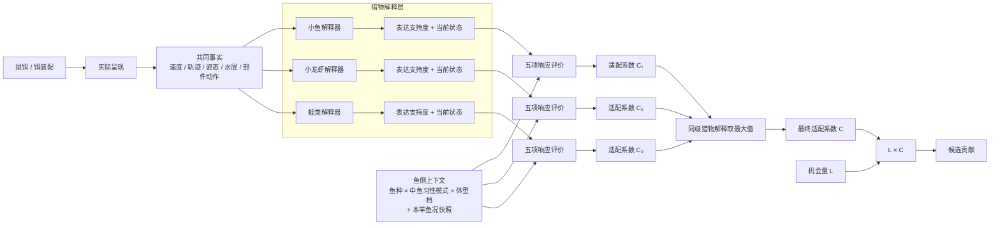

# 路亚响应对齐稿｜2026-10-30 会议版

状态：会议对齐草案 / 候选设计。不是现行契约，不是生产参数。

这份材料只服务于会议讨论：先把玩家为什么需要换策略讲清楚，再解释背后的模块和算法。实现细节、参数标定和数据生产放到会后承接。

---

# 0. 先把范围说清楚：响应分两部分，这次先讲路亚

中鱼阶段的响应（Response）可以先拆成两类：

```text
响应
├─ 持久响应
│  处理会持续一段时间的玩家影响
│  例如打窝、补窝、窝点形成后的持续作用
│
└─ 姿态响应
   处理当前这一竿、当前饵、当前运动与即时呈现
```

不同钓法，重点不同。

| 钓法 | 更偏哪一部分 | 典型内容 |
|---|---|---|
| **路亚** | **姿态响应为主** | 拟饵像什么、怎么游、速度、停顿、逃逸样、终端钓组是否显眼 |
| **台钓** | **持久响应更重，同时保留即时钩饵响应** | 窝料、补窝、味型与食物持续作用；钩饵位置和当前状态仍会影响出手 |
| **浮钓** | **即时呈现为主，部分玩法也会有持久影响** | 钩饵、水层、漂流、状态；涉及窝料时再接持久响应 |

因此这次会议先不试图一次把所有钓法讲完。

> **先把路亚的即时呈现讨论清楚。**
>
> 如果路亚这条链条能闭合，再把其中可复用的分层原则带回台钓和浮钓；不是把路亚公式原样复制过去。

---

# 1. 先看 4 个玩家真正会做的选择

我们做响应，不是为了模拟一套更复杂的“鱼脑”。它必须让玩家在不同鱼情下，真的有理由换打法。

## 选择一：今天它到底想吃什么？

玩家可以用比较泛用的拟饵，也可以换成明显模仿某类猎物的方案，例如小鱼、小龙虾或蛙。

我们希望：

- 当前食性没有明显偏向时，泛用饵仍有竞争力；
- 当前明显偏向某类猎物时，高匹配方案值得玩家换上去。

这个选择最后对应：

```text
拟饵现在像什么猎物
×
鱼当前有多想吃这种猎物
→ 食物价值
```

玩家得到的是：**换不换饵、换成什么饵。**

## 选择二：现在该快搜，还是慢下来精钓？

还不知道鱼在哪时，玩家会希望快速覆盖更多水域；已经找到鱼区，或者当前鱼不适合追高速目标时，玩家应该有理由降速、停顿、细钓。

我们希望：

- 鱼当前适合追时，快速搜索的局部响应仍可接受；
- 鱼当前不适合追时，高速呈现明显吃亏。

这个选择最后对应：

```text
拟饵跑得多快
÷
鱼种 × 体型档的基础追赶能力
再结合当前活跃度
→ 追赶负担
```

快速搜索本身不额外发“搜索奖励”。它真的扫过更多空间，就由机会量承接。

玩家得到的是：**什么时候快搜，什么时候降速。**

## 选择三：鱼不开口时，反应口能不能把它激出来？

普通自然呈现有时已经很合理，但鱼当前摄食动机低，仍缺少“现在就出手”的理由。

某些猎物状态，例如突然逃窜，可以额外促发捕食动作，把部分边缘机会重新推回可用区间。

但我们不希望得到：

> 抽得越乱、动作越多，奖励越高。

所以必须区分：

```text
游得更像猎物
→ 提高猎物表达支持度

猎物当前处于逃逸等状态
→ 才可能形成攻击诱因
```

第一版正式采用的攻击诱因只有 **逃逸样（Escape-like）**。

玩家得到的是：**什么时候自然呈现就够，什么时候反应口值得尝试。**

## 选择四：高警戒鱼，值不值得换更隐蔽的终端钓组？

同一个拟饵、同一个操作，在低警戒鱼面前可以更直接；在高警戒鱼面前，前导线、钩、别针等终端钓组如果过于显眼，应该带来更高代价。

这里要把两件事分开：

```text
鱼有多警戒
→ 警戒度（Wariness）

这次终端钓组有多显眼
→ 可疑负荷（Suspicion Load）
```

两者结合，才形成风险顾虑。

玩家得到的是：**什么时候值得为了隐蔽付出成本。**

---

# 2. 4 个选择，最后收成 5 个评价问题

四个玩家选择最后都汇到同一个问题：

> **这个机会已经摆在鱼面前时，这种鱼、这个体型档、这个中鱼习性模式，对当前呈现到底有多适配？**

第一版响应评价收成五项：

```text
出手余量
= 食物价值
+ 攻击诱因
- 追赶负担
- 风险顾虑
- 摄食意愿门槛
```

再把出手余量投影为最终的 **适配系数 C**，并保证：

```text
0 ≤ C ≤ 1
```

攻击诱因再强，也只能把适配系数推到 1，不会反过来放大基础鱼权重。

---

# 3. 模块图：先解释“像什么”，再评价“值不值得出手”



会议里需要记住的只有一句：

> **拟饵不是猎物类型。一个拟饵可以同时表达多种猎物；系统先让不同猎物解释器分别理解“像不像、现在是什么状态”，再让鱼分别评价。**

实现上可以使用类、策略模式或数据规则；会议不需要先决定代码继承结构。

---

# 4. 猎物解释器负责两件事

每个猎物类型对同一份实际事实做两层解释：

```text
① 现在有多像这种猎物？
→ 猎物表达支持度

② 如果按这种猎物理解，它现在是什么状态？
→ 猎物条件化状态
```

同一段轨迹可以同时：

- 让拟饵“更像小鱼”；
- 在“小鱼”这个解释下，被识别成“正在逃逸”。

前者影响“像不像”；后者才可能进一步形成攻击诱因。

---

# 5. 第一版猎物证据：先用四类

| 证据类型 | 回答什么 | 典型输入 | 边界 |
|---|---|---|---|
| **外观证据（Appearance）** | 它看起来像什么 | 整体轮廓、比例、颜色 / 反光、部件布局 | 不读整体运动 |
| **整体运动证据（Whole-body Motion）** | 整体怎么运动像什么 | 速度模式、方向变化、游 / 爬 / 跳 / 漂 / 下沉 | 不重复局部部件动作 |
| **局部动作证据（Articulation）** | 局部部件怎么动像什么 | 尾摆、腿踢、裙丝动作 | 不重复整体轨迹 |
| **空间关系证据（Spatial Relation）** | 出现在哪里更符合什么猎物 | 水面、近底、中层、触底、离底高度 | 默认只做弱证据，不能单独把不相干的东西变成强猎物身份 |

声音、振动、压力信号第一版不单独列成猎物证据。等以后证明它们真的表达了明确的“像什么”，再加入。

## 5.1 多份证据怎么合

同一份证据可以被动态表现增强：

```text
基础支持度 = b
动态表达匹配程度 = f，范围 0~1
支持度上限 = u

证据得分 = b + (u-b) × f
```

同一份证据有多个动态表达方式时取最强；同一猎物类型有多份替代证据时也默认取最强：

```text
单份证据得分 = max(基础值, 动态规则1, 动态规则2, ...)
猎物表达支持度 = max(所有适用证据得分)
```

不默认相加。只有 A+B 同时存在才形成新语义时，再显式配置“联合证据”。

原来的“动态路线（Dynamic Route）”不再作为独立模块，只保留为猎物解释器内部的动态表达规则。

---

# 6. 姿态：一个当前原子姿态 + 最多一个主导分子姿态

当前运动姿态收成两层：

```text
原子姿态（Atomic Pose）
= 当前这一刻是什么
移动 / 停顿 / 上升 / 下落 / ...

分子姿态（Composite Pose）
= 当前原子姿态 + 必要前史形成的过程
移动→停顿
抽动→停顿
爆发→停顿
爆发→转向→停顿
...
```

每个猎物解释在某个时刻最多保留：

```text
1 个当前原子姿态
+ 0 或 1 个当前主导分子姿态
```

停顿因此是有用的原子姿态，但不做通用“停顿奖励”。它可以进入“抽动→停顿”“爆发→停顿”等猎物特定的组合姿态，也会改变追赶负担和机会量。

同样，不预设“停留越久，机会量 L 必然越大”。停留时间只是机会量的一个输入。

---

# 7. “游得更像”与“额外促发攻击”分开

```text
游得更像某种猎物
→ 猎物表达支持度

当前猎物状态额外促发捕食动作
→ 攻击诱因
```

自然匀速游、正常尾摆，可以明显增强“小鱼表达”，但本身不必产生攻击诱因。

攻击诱因只回答一个更窄的问题：

> **已经接受“这是可吃的猎物”以后，当前状态有没有额外制造“现在扑上去”的理由？**

当前第一版正式采用 **逃逸样**。受伤、挣扎、失衡脆弱状态可以继续作为后续候选，但不在本次会议里扩展。

---

# 8. 鱼侧：先用体型档，不先生成具体鱼

响应允许读取：

```text
鱼种
× 中鱼习性模式
× 体型档
```

不需要先抽出一条“47.3cm / 2.08kg”的具体鱼。

体型档主要进入两个地方：

```text
捕食鱼体型档 + 猎物大小
→ 猎物尺寸偏好修正

鱼种 × 体型档
→ 追赶能力基线
```

因此可以先按体型档计算候选权重；最终选中候选后，再在体型档内生成具体长度、重量和品质。

---

# 9. 追赶第一版再简化：不做鱼和拟饵的相对方位积分

第一版统一采用产品假设：

> **当前形成摄食机会时，鱼正在追拟饵。**

因此直接计算：

```text
速度需求比
= 拟饵相对水体水平速度 / 追赶能力基线

追赶负担
= K_close × 速度需求比² × 活跃度成本倍率
```

不考虑“虽然很快，但刚好迎面朝鱼游来，所以不用追”这种特殊方位。

原因很简单：当前没有真实鱼世界坐标，就不为二阶遭遇几何伪造精度。

---

# 10. 运动可预测性：考虑过，第一版刻意不要

曾经考虑单独给“运动是否容易预测”一个成本，但第一版不做。

因为玩家能感知到的大部分效果已经由其它机制承接：

- 游得更像谁 → 猎物表达支持度；
- 是不是逃逸 / 脆弱 → 攻击诱因；
- 是否太快难追 → 追赶负担；
- 有效交互窗口 / 覆盖 → 机会量；
- 是否露馅 → 风险顾虑。

如果以后把这些因素控制住以后，“纯可预测性”仍然能稳定改变玩家选择，再重开。

这应该在会议里作为一个明确的设计取舍讲出来：**我们考虑过，但主动删掉。**

---

# 11. 风险第一版：只看终端钓组显眼度

风险侧只计算目标饵以外、鱼能感知的终端钓组部件。

每个逻辑部件配置一个显眼度 `c_i`，范围 0~1。

第一版候选聚合：

```text
终端钓组显眼度
= 1 - Π(1-c_i)
```

例如前导线 0.20、钩 0.30：

```text
1 - 0.8 × 0.7 = 0.44
```

首版可以先直接：

```text
可疑负荷 ≈ 终端钓组显眼度
风险顾虑 = K_wary × 警戒度 × 可疑负荷
```

拟饵主体不计入这里：拟饵主体属于猎物表达；目标饵之外的终端钓组才属于“是否露馅”。

---

# 12. 鱼况：一竿一个快照

首版不做鱼况基线的在线有效期状态机。

```text
抛竿开始
→ 解析当前派生环境场 DEF / 环境条件组
→ 读取鱼况基线
→ 生成本竿鱼况快照
→ 本竿响应只读
→ 下一竿重新解析
```

例如 05:59 抛竿，06:00 时段切换，本竿仍使用 05:59 的鱼况快照；下一竿才读取新环境对应的鱼况。

警戒度如果未来需要运行时累积，再单独增加经过授权的运行时叠加；不要因此把活跃度、摄食动机、食性偏移都做成持续刷新状态机。

---

# 13. 适配系数 C 与机会量 L

术语统一：

```text
C = 适配系数
L = 机会量
```

适配系数回答：

> **这个机会已经摆在鱼面前时，这个中鱼习性模式对当前呈现有多适配？**

机会量回答：

> **这个机会实际上有没有形成、形成多少、在哪个时间 / 空间窗口有效？**

最终：

```text
候选贡献 = L × C
```

`L × C` 只乘一次。

同一个物理目标的多个同级猎物解释：

```text
最终适配系数
= max(小鱼解释, 小龙虾解释, 蛙解释, ...)
```

---

# 14. 会议最后只需要留下这些结论

| 会议结论 | 当前口径 |
|---|---|
| 本轮范围 | 先闭合路亚即时姿态响应；台钓 / 浮钓后续承接 |
| 拟饵和猎物 | 一个拟饵可以同时表达多种猎物，不先选唯一身份 |
| 猎物解释 | 各猎物解释器分别产出表达支持度和当前状态 |
| 证据 | 第一版四类：外观、整体运动、局部动作、空间关系 |
| 姿态 | 1 个原子姿态 + 0/1 个主导分子姿态 |
| 攻击诱因 | 只表达额外捕食促发；第一版采用逃逸样 |
| 鱼体型 | 先用体型档参与响应，不要求先生成具体鱼 |
| 追赶 | 第一版按“鱼在追拟饵”估算，不做相对方位积分 |
| 风险 | 终端钓组显眼度用简单饱和聚合 |
| 鱼况 | 一竿一个鱼况快照 |
| 最终系数 | C 叫适配系数，范围 0~1 |
| 机会 | L 叫机会量；最终只做一次 L × C |
| 刻意不做 | 独立运动可预测性、通用停顿奖励、复杂遭遇几何 |

会后再继续做具体数据、采样、阈值和生产标定。