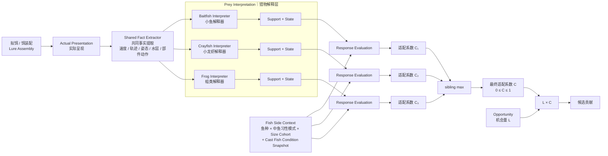
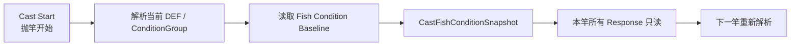

# 路亚 Response 对齐稿｜2026-10-30 会议草案

状态：Meeting Alignment Draft / Candidate。不是 Current Contract，不是生产参数。

当前工作分支：`futou-/exciting-payne-95a562`。本稿按 `01807b10` 之后的 Owner 直接裁定继续收口，重点用于会议说明。核心 Contract 仍需随后同步；本文不把未落仓的机制自动升级为已审核 Contract。

本轮新增并按 Owner 口径采用：

- Prey Type 自己解释 `Support + State`；实现可用 class / strategy / 数据规则，不强制 OO 继承；
- 当前运动姿态按“1 个原子姿态 + 0/1 个主导分子姿态”表达；
- Dynamic Route 降为 Prey Interpreter 内部的“动态表达规则”，不作为独立业务层；
- AttackTrigger 只表达猎物状态对捕食出手的额外促发，不承担“游得更像”的一般拟真价值；
- `C` 正式沿用术语表名称：**适配系数**，并保持 `0 ≤ C ≤ 1`；
- Response 可读取 `Species × Engagement Mode × Size Cohort`，不要求先生成具体鱼个体；
- `TackleConspicuousness = 1 - Π(1-c_i)` 作为第一版 Candidate 聚合；
- Prediction 不进入预期路线，会议材料保留为“刻意不做”的设计取舍；
- **去掉 θ / latent bearing**：首版统一按“鱼正在追拟饵”估算追赶负担，不模拟迎面而来等相对方位特例；
- **一竿一 Fish Condition Snapshot**：抛竿开始时按当前 DEF / ConditionGroup 解析 baseline，本竿固定读取；下一竿重新解析。

---

## 0. 这次会议希望先对齐什么

不是先讨论一堆系数，而是先把对象、职责和玩家策略讲清楚：

1. 一个拟饵为什么可以同时表达多种猎物；
2. “像什么”和“现在是什么状态”由谁解释；
3. 鱼如何把猎物解释、鱼况和自身能力合成适配系数；
4. 哪些复杂度第一版刻意不做；
5. 哪些量仍交给 Opportunity，而不是塞回 Response。

---

# 1. 核心模块图：同一个呈现，被多个猎物解释器并行解读



核心 mental model：

> **拟饵不是猎物类型。一个拟饵可以表达多个 Prey Type。系统先并行解释“像什么、现在是什么状态”，再让鱼分别评价这些解释，最后同级解释取 max。**

Prey Interpreter 是语义 owner；实现可以是 class、Strategy 或数据规则。Contract 不要求一定写成继承树。

---

# 2. Prey Interpreter 内部做两件事

每个 Prey Type 对同一份实际事实做两层解释：

```text
共同事实
  ↓
① Support Interpretation
   现在有多像这种猎物？
  ↓
② State Interpretation
   如果按这种猎物理解，它现在是什么状态？
```

## 2.1 Evidence V1：四类就够

| Evidence Family | 中文 | 回答什么 | 典型输入 | 边界 |
|---|---|---|---|---|
| `Appearance` | 外观证据 | 它看起来像什么 | 整体轮廓、比例、颜色 / 反光、部件布局 | 不读整体运动 |
| `WholeBodyMotion` | 整体运动证据 | 整体怎么运动像什么 | 速度模式、方向变化、游 / 爬 / 跳 / 漂 / 下沉 | 不重复局部部件动作 |
| `Articulation` | 局部动作证据 | 局部部件怎么动像什么 | 尾摆、腿踢、裙丝动作、局部摆动 | 不重复整体轨迹 |
| `SpatialRelation` | 空间关系证据 | 出现在哪里更符合什么猎物 | 水面、近底、中层、触底、离底高度 | 默认弱证据，不能单独把不相干外观变成强猎物身份 |

`Sound / Vibration / Pressure` 第一版不单列为 Prey Evidence Family。只有未来证明它们具备明确 prey-specific 身份语义时再准入，避免滑成“刺激越强越容易咬”。

## 2.2 Evidence 聚合

同一 Evidence 内部可以有“动态表达规则”：

```text
base_support = b
动态表达匹配 f ∈ [0,1]
support_ceiling = u

s = b + (u-b) × f
```

同一 Evidence 有多种动态表达时取最强；同一 Prey Type 有多份替代 Evidence 时也默认取最强：

```text
EvidenceScore = max(base, dynamic_rule_1, dynamic_rule_2, ...)
PreySupport   = max(all applicable evidence scores)
```

不默认相加。需要 A+B 才形成新语义时，明确配置 Joint Evidence / Joint Expression，避免作者把一个事实拆得越细，support 就越高。

### Dynamic Route 为什么还存在

它不再是一个独立业务模块，只是 Interpreter 内部的“动态表达规则”。例如：

```text
鱼形外观 → baitfish base support 0.60
正常游动 + 尾摆 → 把同一解释增强到更高 support
```

它回答的是“**这样运动以后更像不像小鱼**”，不回答“**鱼是不是因此更想立刻扑上去**”。后一个问题属于 AttackTrigger。

---

# 3. 姿态：一个当前原子姿态 + 最多一个主导分子姿态

为了避免状态标签爆炸，当前运动姿态收成两层：

```text
Atomic Pose 原子姿态
= 当前这一刻是什么
Move / Pause / Rise / Fall / ...

Composite Pose 分子姿态
= 当前原子姿态 + 必要前史形成的过程
Move→Pause
Twitch→Pause
Burst→Pause
Burst→Turn→Pause
...
```

每个 Prey Interpretation 在某个时刻最多保留：

```text
1 个当前 Atomic Pose
+ 0 或 1 个当前主导 Composite Pose
```

若多个 Composite 同时满足，Interpreter 选择更具体、解释力更强的一个；不把多个过程标签同时变成 Bonus。

水面、近底、侧翻角、离底距离等继续作为正交事实 / 状态维度，不算额外“姿态”。

Pause 因此是有用的原子姿态，但没有通用 `PauseBonus`。它可以：

- 组成 `Twitch→Pause`、`Burst→Pause` 等 prey-specific 分子姿态；
- 让当前速度下降，从而改变追赶负担；
- 让 Opportunity 重新评价当前机会。

**不预设“停留越久，L 必然越大”。** duration / dwell 只是 Opportunity 输入；在错误水层、无效窗口或覆盖效率下降时，多停不一定更好。

---

# 4. “游得更像”与 AttackTrigger 分开

```text
更像某种猎物
→ Prey Support

当前状态额外促发捕食动作
→ AttackTrigger
```

例如自然匀速游、正常尾摆，可以显著增强 baitfish support，但本身不必产生 Trigger。

AttackTrigger 的问题更窄：

> 已经接受“这是可吃的猎物”以后，当前状态有没有额外制造“现在扑上去”的理由？

当前第一版正式准入只有 **Escape-like / 逃逸样**。`Injured / Struggling`、失衡脆弱状态仍可作为后续候选；pause 本身不自动成为 Trigger。

```text
StateTriggerValue
= TriggerBudget × TriggerIntensity
```

Trigger 只增加 DecisionMargin。最终适配系数始终经过 0~1 投影：

```text
C = clamp((Margin - M0) / (M1 - M0), 0, 1)
```

所以 Trigger 再强也只能把 `C` 推到 1，不会出现 `C > 1`，不会反过来放大基础强度。

---

# 5. 鱼侧：不是先生成具体鱼，而是先用 Size Cohort

Response 允许读取：

```text
Species
× Engagement Mode
× Size Cohort
```

不要求先抽出一条“47.3cm / 2.08kg”的具体鱼。

两个地方会用到 cohort：

```text
predator size cohort + prey size
→ SizePreferenceAdjustment

species × size cohort
→ InterceptSpeedLimit
```

因此可以先按 cohort 计算候选权重；最终选中候选后，再在 cohort 内生成具体长度、重量和品质。

这保留了“先算鱼权重，再抽具体个体”的生产顺序，同时允许大鱼和小鱼对猎物尺寸、追赶能力表现不同。

---

# 6. Response 第一版：五个评价项，去掉 θ

第一版主公式仍是：

```text
DecisionMargin
= FoodValue
+ AttackTrigger
- ClosingCost
- RiskCost
- WillingnessThreshold
```

## 6.1 Closing 简化

首版**不再模拟 latent bearing θ**，统一采用产品假设：

> 当前形成摄食机会时，鱼正在追拟饵。

因此：

```text
q = 拟饵相对水体水平速度 / InterceptSpeedLimit

ClosingCost
= K_close × q² × ActivityCostMultiplier(Activity)
```

不考虑“虽然很快，但刚好迎面朝鱼游过来，所以不用追”的特殊情况。原因不是声称现实不存在，而是没有真实鱼世界坐标时，不为二阶 encounter geometry 伪造精度。

若未来真的获得鱼距、相对方向、strike reach、reaction window 等稳定事实，再单独重开完整 encounter geometry。

## 6.2 Prediction 不做

曾考虑独立的“运动可预测性 / PredictionCost”，第一版刻意不要。

因为大部分玩家可感知效果已经被其它机制承接：

- 游得更像谁 → Prey Support；
- 是不是逃逸 / 脆弱 → AttackTrigger；
- 是否太快难追 → Closing；
- 有效交互窗口 / 覆盖 → Opportunity；
- 是否露馅 → Risk。

只有控制这些因素后，纯可预测性仍稳定改变策略排序，才值得重开。会议中应把它作为“考虑过但主动删掉的复杂度”。

---

# 7. Risk 第一版：终端钓组显眼度简单聚合

风险侧只计算目标饵以外、鱼能感知的终端钓组部件。

每个逻辑部件配置：

```text
c_i = Conspicuousness ∈ [0,1]
```

第一版 Candidate：

```text
TackleConspicuousness
= 1 - Π(1-c_i)
```

例如前导线 0.20、钩 0.30：

```text
1 - 0.8 × 0.7 = 0.44
```

首版可以直接：

```text
SuspicionLoad ≈ TackleConspicuousness
RiskCost = K_wary × Wariness × SuspicionLoad
```

拟饵主体不计入 TackleConspicuousness：它属于 prey expression，不属于“目标饵之外的终端钓组暴露”。后续若确有必要，再叠加水体透明度、光照等 visibility context。

---

# 8. Fish Condition：一竿一个 Snapshot

baseline 不做在线 TTL 状态机。首版采用 Cast Snapshot：



例如 05:59 抛竿，06:00 时段切换，本竿仍使用 05:59 形成的 Snapshot；下一竿才读取新的 DEF。

因此 baseline 的核心失败情况变成：

- 抛竿开始时找不到对应 DEF / ConditionGroup；
- Fish Condition block 缺必要值或来源；
- 值非法；
- 版本不一致，无法形成 Snapshot。

Wariness 如果未来真的需要 runtime accumulation，再在 snapshot 之上做单独授权的 overlay；不要因此把 Activity / Motivation / Diet Shift 都做成持续刷新状态机。

---

# 9. 适配系数 C 与机会量 L

术语统一：

```text
C = 适配系数 Adaptation Coefficient
L = 机会量 / Opportunity Support
```

适配系数回答：

> **这个机会已经摆在鱼面前时，这个 Engagement Mode 对当前呈现有多适配？**

机会量回答：

> **这个机会实际上有没有形成、形成多少、在哪个时间 / 空间窗口有效？**

最终：

```text
候选贡献 q = L × C
```

`L × C` 只乘一次。

同一个 physical target 的多个 sibling prey interpretations：

```text
C_final = max(C_baitfish, C_crayfish, C_frog, ...)
```

这个 `max` 只用于同一 Feeding route 的替代 prey interpretations，不自动授权其它 Interaction family 也使用 universal max。

---

# 10. 这版会议应明确讲出的“刻意简化”

| 刻意不做 | 第一版为什么不做 |
|---|---|
| Prediction / 运动可预测性 | 与 Support、Trigger、Closing、Opportunity 高度重叠，尚未证明残余策略价值 |
| θ / 鱼与拟饵相对方位积分 | 没有鱼的真实位置，不伪造 encounter geometry；首版按“鱼在追拟饵”统一估算 |
| PauseBonus | Pause 已能进入 prey pattern、Closing 与 Opportunity，不再匿名加分 |
| “停越久 L 越大” | Opportunity 应根据有效窗口求值，duration 不是单调奖励 |
| 具体鱼个体先生成 | Response 先用 Size Cohort，选中后再抽具体个体 |
| 复杂视觉显眼度模型 | 先用终端钓组部件简单饱和聚合，数据不足时不提前模拟 |

这不是少做，而是让每个复杂度只有在购买独立玩法价值时才进入系统。

---

# 11. 当前仍需要继续做的工作

已经不需要重开的：Prey Interpreter 职责、Evidence V1 四类、Atomic + Composite Pose、去 Prediction、去 θ、一竿一 Snapshot、C 叫适配系数、Size Cohort 可以进入 Response。

接下来主要是生产化：

1. 各 Prey Type 的具体 Evidence / Dynamic Expression Rules；
2. Escape-like 的采样、滤波、窗口与 TriggerIntensity 映射；
3. `SizePreferenceAdjustment(prey size, predator size cohort)` 的生产形态；
4. `InterceptSpeedLimit(species, size cohort)` 数据来源；
5. `TackleConspicuousness` 的部件字段与默认配置；
6. Opportunity `L` 的生产函数、单位、窗口与 reducer；
7. 四个 Fish Condition 的 baseline 生成曲线与标定。

这些属于后续 Contract / 数据生产问题，不再反向改变本稿的模块拓扑。
