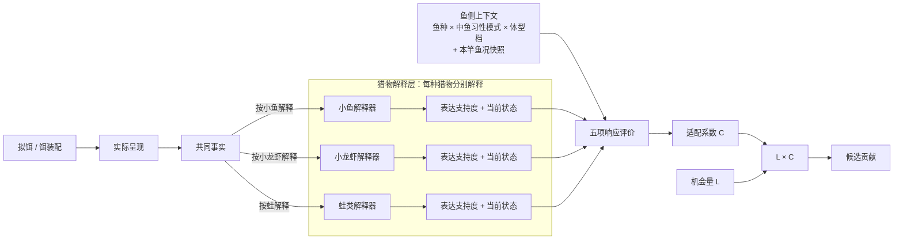

# 响应系统思路：提案思路同步

状态：会议对齐草案 / 候选设计。不是现行契约，不是生产参数。

本页按投屏讲解组织：每节先给结论，再给必要解释；参数、采样和生产细节留到会后。

> 与设计包的同步状态（2026-10-31 更新）：本稿的四项方向（去掉相对方位 θ、终端钓组显眼度聚合、同级猎物解释取最大、一竿一鱼况快照）已由 PR [#171](https://github.com/futouyiba/HitFish-Up/pull/171)（合并提交 `ad2ccb5f`）回写进设计包与 probe。实现以设计包与 probe 为准；终端钓组显眼度字段与 owner 落地前，风险顾虑保持为 0。

---

# 0. 响应不是一个模块，是三类问题

```text
响应
├─ 饵料混合
│  配方、味型、状态、混合比例
│
├─ 姿态操作
│  当前这一竿的姿态、运动与即时呈现
│
└─ 打窝
   持续一段时间的窝料影响，形成窝点
```

不同钓法，主要落在不同的块上。

| 钓法 | 主要落在哪块 | 典型内容 |
|---|---|---|
| **路亚** | **姿态操作** | 拟饵像什么、怎么游、速度、停顿、逃逸样、终端钓组是否显眼 |
| **台钓** | **饵料混合为主，打窝为辅** | 饵料配方、味型、状态、混合比例；补窝改变窝点 |
| **浮钓** | **饵料混合与即时呈现** | 饵料状态、水层、漂流；涉及窝料时接打窝 |

> **这次会议只把路亚的姿态操作讲清楚。**
>
> 饵料混合与打窝后续单独讲。可复用过去的是“先解释、再评价”的分层原则，不是路亚公式。

---

# 1. 玩家实际在做的 4 个选择

我们做响应，不是为了模拟一套更复杂的“鱼脑”。它必须让玩家在不同鱼情下，真的有理由换打法。

## 选择一：泛用，还是专精匹配？

玩家可以带一个很多鱼都吃的泛用饵，也可以换成明显模仿当前猎物的方案，例如小鱼、小龙虾或蛙。

我们希望：

- 鱼的食性没有明显偏向时，泛用饵仍有竞争力；
- 鱼明显偏向某类猎物时，专精匹配值得换上去。

**玩家的选择：换不换饵，换成什么。**

## 选择二：快搜，还是慢钓？

还不知道鱼在哪时，玩家希望快速覆盖更多水域；已经找到鱼区，或者当前鱼不适合追高速目标时，玩家应该有理由降速、停顿、细钓。

我们希望：

- 鱼当前适合追时，快速搜索的局部响应仍可接受；
- 鱼当前不适合追时，高速呈现明显吃亏。

**玩家的选择：什么时候快搜，什么时候降速。**

## 选择三：自然呈现，还是反应口？

自然呈现有时已经很合理，但鱼当前摄食动机低，仍缺少“现在就出手”的理由。逃逸样等猎物状态，可以额外促发捕食动作。

我们不希望变成“抽得越乱、动作越多，奖励越高”。

**玩家的选择：什么时候自然呈现就够，什么时候值得做反应口。**

## 选择四：直接，还是隐蔽？

低警戒鱼面前可以更直接；高警戒鱼面前，前导线、钩、别针等终端钓组如果过于显眼，应该付出更高代价。

**玩家的选择：什么时候值得为了隐蔽付出成本。**

---

# 2. 从这 4 个选择，推出我们需要 5 个评价问题

| 玩家选择 | 要回答的问题 | 落到哪个评价项 |
|---|---|---|
| 泛用还是专精 | 这个目标本身值不值得吃 | 食物价值 |
| 快搜还是慢钓 | 当前呈现对这条鱼有多难追 | 追赶负担 |
| 自然还是反应口 | 当前猎物状态是否额外促发出手 | 攻击诱因 |
| 直接还是隐蔽 | 这次呈现有多容易露馅 | 风险顾虑 |
| 共同前提 | 现在需要多强的理由才出手 | 摄食意愿门槛 |

五个问题在同一标尺上竞争，收成一个出手余量：

```text
出手余量
= 食物价值
+ 攻击诱因
- 追赶负担
- 风险顾虑
- 摄食意愿门槛
```

再投影成适配系数 C，范围 0~1。攻击诱因再强，也只能把 C 推到 1，不会反过来放大基础鱼权重。

---

# 3. 系统怎么走：先解释，再评价，最后乘机会

三步：

1. **拆共同事实。** 把这一竿的呈现拆成速度、轨迹、姿态、水层、部件动作，不先判断“它是什么”。
2. **每种猎物分别解释。** 同一个饵不用先选一种身份，可以同时被当成小鱼、小龙虾或蛙。每个猎物解释器用自己的规则回答两件事：有多像这种猎物（表达支持度）；按这种猎物看，它现在在干什么（当前状态）。
3. **鱼侧评价。** 鱼种、中鱼习性模式、体型档和本竿鱼况把五项评价合成适配系数 C；机会量 L 只乘一次，得到候选贡献。



一句话：拟饵不是猎物类型：同一个饵可以同时被解释成小鱼、小龙虾或蛙；系统分别解释“像不像、现在什么状态”，再让鱼评价。

---

# 4. 猎物解释器的价值：一个饵，多种解释，分开买策略

为什么不先给拟饵选一个唯一猎物身份：

- 同一个拟饵可以同时像小鱼和小龙虾；强行选一个，等于替玩家和鱼做了系统自己没做的判断；
- 玩家选择“泛用还是专精”，本质是选择让哪些解释拿到支持度；
- 鱼当前想吃哪种，由鱼侧上下文决定，不由饵的出厂标签决定。

所以每个猎物解释器输出两件事：

```text
① 表达支持度：现在有多像这种猎物
② 当前状态：按这种猎物看，它现在在干什么
```

它体现的策略选择：

- **泛用饵**：多个解释都有中等支持，靠鱼当前想吃什么来结算；
- **专精饵**：一种解释拿到高支持，鱼偏向这种猎物时收益明显；
- **换饵时机**：鱼侧偏向变化时，专精与泛用的排序会翻转。

同一物理目标的多个解释互斥，不叠加：

```text
最终适配系数 = max(各猎物解释的适配系数)
```

---

# 5. 判断像不像：第一版先用四类信号

| 信号类型 | 回答什么 | 典型输入 | 边界 |
|---|---|---|---|
| **外观信号（Appearance）** | 它看起来像什么 | 整体轮廓、比例、颜色 / 反光、部件布局 | 不读整体运动 |
| **整体运动信号（Whole-body Motion）** | 整体怎么运动像什么 | 速度模式、方向变化、游 / 爬 / 跳 / 漂 / 下沉 | 不重复局部部件动作 |
| **局部动作信号（Articulation）** | 局部部件怎么动像什么 | 尾摆、腿踢、裙丝动作 | 不重复整体轨迹 |
| **空间关系信号（Spatial Relation）** | 出现在哪里更符合什么猎物 | 水面、近底、中层、触底、离底高度 | 默认只做弱信号，不能单独把不相干的东西变成强猎物身份 |

声音、振动、压力第一版不单独作为一类信号。等以后证明它们真的表达了明确的“像什么”，再加入。

同一类信号可以被动态表现增强：

```text
基础支持度 = b
动态表达匹配程度 = f，范围 0~1
支持度上限 = u

信号得分 = b + (u-b) × f
```

同一类信号有多个动态表达方式时取最强；同一猎物类型有多份替代信号时也默认取最强：

```text
单份信号得分 = max(基础值, 动态规则1, 动态规则2, ...)
猎物表达支持度 = max(所有适用信号得分)
```

不默认相加。只有 A+B 同时存在才形成新语义时，再显式配置“联合信号”。

原来作为独立模块的动态路线（Dynamic Route），现在只作为猎物解释器内部的动态表达规则。

---

# 6. 姿态：一个当前原子姿态 + 最多一个主导分子姿态

当前运动姿态收成两层：

```text
原子姿态（Atomic Pose）
= 当前这一刻是什么
移动 / 停顿 / 上升 / 下落 / ...

分子姿态（Composite Pose）
= 当前原子姿态 + 必要前史形成的过程
移动→停顿
抽动→停顿
爆发→停顿
爆发→转向→停顿
...
```

每个猎物解释在某个时刻最多保留：

```text
1 个当前原子姿态
+ 0 或 1 个当前主导分子姿态
```

停顿因此是有用的原子姿态，但不做通用“停顿奖励”。它可以进入“抽动→停顿”“爆发→停顿”等猎物特定的组合姿态，也会改变追赶负担和机会量。

同样，不预设“停留越久，机会量 L 必然越大”。停留时间只是机会量的一个输入。

---

# 7. “游得更像”与“额外促发攻击”分开

```text
游得更像某种猎物
→ 猎物表达支持度

当前猎物状态额外促发捕食动作
→ 攻击诱因
```

自然匀速游、正常尾摆，可以明显增强“小鱼表达”，但本身不必产生攻击诱因。

攻击诱因只回答一个更窄的问题：

> **已经接受“这是可吃的猎物”以后，当前状态有没有额外制造“现在扑上去”的理由？**

当前第一版正式采用 **逃逸样**。受伤、挣扎、失衡脆弱状态可以继续作为后续候选，但不在本次会议里扩展。

---

# 8. 鱼侧：先用体型档，不先生成具体鱼

响应允许读取：

```text
鱼种
× 中鱼习性模式
× 体型档
```

不需要先抽出一条“47.3cm / 2.08kg”的具体鱼。

体型档主要进入两个地方：

```text
捕食鱼体型档 + 猎物大小
→ 猎物尺寸偏好修正

鱼种 × 体型档
→ 追赶能力基线
```

因此可以先按体型档计算候选权重；最终选中候选后，再在体型档内生成具体长度、重量和品质。

---

# 9. 追赶第一版：不做鱼和拟饵的相对方位积分

第一版统一采用产品假设：

> **当前形成摄食机会时，鱼正在追拟饵。**

因此直接计算：

```text
速度需求比
= 拟饵相对水体水平速度 / 追赶能力基线

追赶负担
= K_close × 速度需求比² × 活跃度成本倍率
```

不考虑“虽然很快，但刚好迎面朝鱼游来，所以不用追”这种特殊方位。

原因很简单：当前没有真实鱼世界坐标，就不为二阶遭遇几何伪造精度。

---

# 10. 运动可预测性：考虑过，第一版刻意不要

曾经考虑单独给“运动是否容易预测”一个成本，但第一版不做。

因为玩家能感知到的大部分效果已经由其它机制承接：

- 游得更像谁 → 猎物表达支持度；
- 是不是逃逸 / 脆弱 → 攻击诱因；
- 是否太快难追 → 追赶负担；
- 有效交互窗口 / 覆盖 → 机会量；
- 是否露馅 → 风险顾虑。

如果以后把这些因素控制住以后，“纯可预测性”仍然能稳定改变玩家选择，再重开。

这是一个明确的设计取舍：考虑过，但第一版主动不做。

---

# 11. 风险第一版：只看终端钓组显眼度

风险侧只计算目标饵以外、鱼能感知的终端钓组部件。

每个逻辑部件配置一个显眼度 `c_i`，范围 0~1。

第一版候选聚合：

```text
终端钓组显眼度
= 1 - Π(1-c_i)
```

例如前导线 0.20、钩 0.30：

```text
1 - 0.8 × 0.7 = 0.44
```

首版可以先直接：

```text
可疑负荷 ≈ 终端钓组显眼度
风险顾虑 = K_wary × 警戒度 × 可疑负荷
```

拟饵主体不计入这里：拟饵主体属于猎物表达；目标饵之外的终端钓组才属于“是否露馅”。

---

# 12. 鱼况：一竿一个快照

首版不做鱼况基线的在线有效期状态机。

```text
抛竿开始
→ 解析当前派生环境场 DEF / 环境条件组
→ 读取鱼况基线
→ 生成本竿鱼况快照
→ 本竿响应只读
→ 下一竿重新解析
```

例如 05:59 抛竿，06:00 时段切换，本竿仍使用 05:59 的鱼况快照；下一竿才读取新环境对应的鱼况。

警戒度如果未来需要运行时累积，再单独增加经过授权的运行时叠加；不要因此把活跃度、摄食动机、食性偏移都做成持续刷新状态机。

---

# 13. 适配系数 C 与机会量 L

```text
C = 适配系数
L = 机会量
```

适配系数回答：

> **这个机会已经摆在鱼面前时，这个中鱼习性模式对当前呈现有多适配？**

机会量回答：

> **这个机会实际上有没有形成、形成多少、在哪个时间 / 空间窗口有效？**

最终：

```text
候选贡献 = L × C
```

`L × C` 只乘一次。

---

# 14. 概念清单：有哪些概念，谁流向谁

| 概念 | 回答什么 | 由谁产生 | 流向 |
|---|---|---|---|
| 实际呈现 | 这一竿实际是什么 | 玩家操作 + 环境 | 共同事实 |
| 共同事实 | 可复用的客观输入 | 事实提取 | 各猎物解释器 |
| 表达支持度 | 有多像这种猎物 | 猎物解释器 | 五项评价 |
| 当前状态 | 按这种猎物看，现在在干什么 | 猎物解释器 | 攻击诱因 |
| 鱼侧上下文 | 鱼是谁、当前状态如何 | 鱼种配置 + 本竿鱼况快照 | 五项评价 |
| 五项评价 | 值不值得出手 | 评价规则 | 出手余量 |
| 出手余量 | 五项净值 | 相加 | 适配系数 |
| 适配系数 C | 这个机会有多适配 | 投影 | 候选贡献 |
| 机会量 L | 机会形成了多少 | Opportunity | 候选贡献 |
| 候选贡献 | 最终进入候选的量 | `L × C` | 候选 |

主链：

```text
实际呈现
→ 共同事实
→ 各猎物解释（表达支持度 + 当前状态）
→ 五项评价（鱼侧上下文参与）
→ 出手余量
→ 适配系数 C
→ 候选贡献（L × C）
```

---

# 15. 会议结论

| 会议结论 | 当前口径 |
|---|---|
| 响应拆解 | 饵料混合、姿态操作、打窝三类问题 |
| 本轮范围 | 先闭合路亚姿态操作；饵料混合与打窝后续承接 |
| 拟饵和猎物 | 一个拟饵可以同时表达多种猎物，不先选唯一身份 |
| 猎物解释 | 各猎物解释器分别产出表达支持度和当前状态 |
| 信号 | 第一版四类：外观、整体运动、局部动作、空间关系 |
| 姿态 | 1 个原子姿态 + 0/1 个主导分子姿态 |
| 攻击诱因 | 只表达额外捕食促发；第一版采用逃逸样 |
| 鱼体型 | 先用体型档参与响应，不要求先生成具体鱼 |
| 追赶 | 第一版按“鱼在追拟饵”估算，不做相对方位积分 |
| 风险 | 终端钓组显眼度用简单饱和聚合 |
| 鱼况 | 一竿一个鱼况快照 |
| 最终系数 | C 叫适配系数，范围 0~1 |
| 机会 | L 叫机会量；最终只做一次 L × C |
| 刻意不做 | 独立运动可预测性、通用停顿奖励、复杂遭遇几何 |

会后再继续做具体数据、采样、阈值和生产标定。
