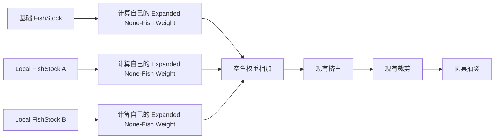
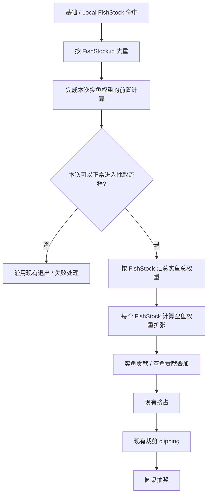

# 0.3.4.1｜空鱼权重优化｜开发需求

> **所属版本：** 0.3.4.1  
> **任务：** 空鱼权重优化  
> **文档状态：** 已选执行方案 / 开发需求完善中  
> **文档版本：** v0.4  
> **Last Updated：** 2026-10-16（Asia/Taipei）  
> **文档定位：** 本文是 0.3.4.1 的一个开发任务文档，只描述空鱼权重相关改动，不代表 0.3.4.1 的全部内容。

本文主要回答：**空鱼权重怎么改、配置加在哪里、什么时候计算、多个 FishStock 同时生效时怎么处理，以及如何接入现有挤占、裁剪和圆桌流程。**

`real_fish_weight_anchor` 与 `none_fish_weight_expansion_rate` 的具体配置方法、推荐值和卧龙（Wolong）校验规则另文说明。交验、服务端权威与跨端一致性本任务暂不处理，后续统一处理。

---

## 0. 本期改动概览

本任务包含两项改动。

### 改动 A｜实鱼总权重过高时，增加空鱼权重

每个 `FishStock` 在已有 `none_fish_weight` 基础上新增：

| 字段 | 中文名 | 类型 | 默认值 |
|---|---|---:|---:|
| `real_fish_weight_anchor` | 实鱼总权重锚点 | `INT32` | `0` |
| `none_fish_weight_expansion_rate` | 空鱼权重扩张率 | `FLOAT` | `0.0` |

当一个 `FishStock` 的实鱼总权重不超过锚点时，沿用原来的空鱼权重。

超过锚点后，只对超出的部分按扩张率增加空鱼权重。

### 改动 B｜多个 FishStock 同时生效时，空鱼权重也叠加

历史逻辑会叠加不同 FishStock 的实鱼贡献，但局部 FishStock 的空鱼权重不参与最终计算。

0.3.4.1 改为：

> **每个有效 FishStock 先独立算出自己的扩张后空鱼权重，再把这些空鱼权重相加。**

整体流程：

```text
确定本次有效 FishStock
→ 每个 FishStock 得到自己的实鱼总权重
→ 每个 FishStock 独立计算空鱼权重扩张
→ 各 FishStock 的实鱼贡献、空鱼贡献分别叠加
→ 现有挤占
→ 现有裁剪（clipping）
→ 圆桌抽奖
```

---

# 1. 背景与目标

当前权重体系有一个合理的基本反馈：

```text
实鱼权重提高
→ 实鱼总权重提高
→ 抽到任意鱼的概率提高
→ 中鱼更快
```

这个方向应当保留。

问题在于：同一个 FishStock 中可能有多条鱼同时获得较高权重；区域重叠时，也可能同时生效多个 FishStock。此时实鱼总权重会明显增加，如果空鱼权重完全不随之调整，整体鱼口可能增长得过快。

0.3.4.1 的空鱼权重优化只解决这个问题：

> **实鱼总权重超过正常高效区间后，不降低实鱼权重，而是增加空鱼权重，使鱼口仍然可以继续变旺，但增速变得更温和。**

本任务不改变上游鱼习性、环境、Response 等机制如何得到单鱼权重，也不新增目标鱼 / 保底鱼等运行时分类。

---

# 2. 概念与符号

| 中文概念 | 英文名词 | 含义 | 数学表示 | KaTeX |
|---|---|---|---|---|
| **权重池** | FishStock | 本任务的配置和计算单位。 | \(k\) | `k` |
| **局部权重池** | Local FishStock | 由区域命中后附加生效的 FishStock。 | — | — |
| **实鱼权重** | Real Fish Weight | 单条鱼在本任务计算时使用的实鱼权重。 | \(W_{i,k}\) | `W_{i,k}` |
| **实鱼总权重** | Total Real Fish Weight | 某个 FishStock 内所有实鱼权重之和。 | \(W_{\Sigma,k}\) | `W_{\Sigma,k}=\sum_i W_{i,k}` |
| **基础空鱼权重** | Base None-Fish Weight | FishStock 原有的 `none_fish_weight`。 | \(E_{0,k}\) | `E_{0,k}` |
| **实鱼总权重锚点** | Real Fish Weight Anchor | 实鱼总权重超过该值后，开始增加额外空鱼权重。 | \(A_k\) | `A_k` |
| **超额实鱼权重** | Excess Real Fish Weight | 实鱼总权重超过锚点的部分。 | \(X_k\) | `X_k=\max(0,W_{\Sigma,k}-A_k)` |
| **空鱼权重扩张率** | None-Fish Weight Expansion Rate | 每增加 1 单位超额实鱼权重，需要增加多少单位空鱼权重。 | \(S_k\) | `S_k` |
| **扩张后空鱼权重** | Expanded None-Fish Weight | 单个 FishStock 完成本任务计算后的空鱼权重。 | \(E_{e,k}\) | `E_{e,k}=E_{0,k}+S_kX_k` |
| **叠加空鱼权重** | Stacked None-Fish Weight | 本次所有有效 FishStock 的扩张后空鱼权重之和。 | \(E_{\text{stack}}\) | `E_{\text{stack}}=\sum_kE_{e,k}` |

本文后续统一使用“**空鱼权重扩张**”描述新增逻辑。

---

# 3. 核心机制

## 3.1 单个 FishStock：先判断实鱼总权重，再增加空鱼权重

对每个有效 FishStock，先把当前实鱼权重加总。

- **实鱼总权重不超过锚点：**不增加额外空鱼权重，继续使用基础空鱼权重。
- **实鱼总权重超过锚点：**只取超过锚点的部分，乘以空鱼权重扩张率，再加到基础空鱼权重上。
- **整个过程不修改任何实鱼权重。**

计算分三步。

### 第一步：求实鱼总权重

$$
W_{\Sigma,k}=\sum_iW_{i,k}
$$

### 第二步：求超额实鱼权重

$$
X_k=\max(0,W_{\Sigma,k}-A_k)
$$

### 第三步：求扩张后空鱼权重

$$
E_{e,k}=E_{0,k}+S_kX_k
$$

也就是：

$$
E_{e,k}
=
E_{0,k}
+
S_k\max(0,W_{\Sigma,k}-A_k)
$$

---

## 3.2 多个 FishStock：先各自处理，再叠加空鱼权重

当基础 FishStock 与一个或多个 Local FishStock 同时生效时，不把它们先合成一个大池再计算。

处理顺序是：

1. **每个 FishStock 先看自己的实鱼总权重是否超过自己的锚点；**
2. **每个 FishStock 独立算出自己的扩张后空鱼权重；**
3. **最后把所有有效 FishStock 的扩张后空鱼权重相加。**

因此，各 FishStock 的锚点和扩张率始终只解释自己的数据，不需要设计“多个锚点怎么合”“多个扩张率怎么平均”。

空鱼权重叠加：

$$
E_{\text{stack}}=\sum_kE_{e,k}
$$

展开后：

$$
E_{\text{stack}}
=
\sum_k
\left[
E_{0,k}
+
S_k\max(0,W_{\Sigma,k}-A_k)
\right]
$$

实鱼侧继续沿用现有 FishStock 的拼接 / 聚合规则。



---

# 4. 计算时机与执行顺序

## 4.1 先确定本次有哪些 FishStock 生效

现有逻辑会得到：

```text
基础 FishStock
+ 命中的 Local FishStock
```

同一个逻辑区域可能由多个 Collider / Trigger 表达。如果它们都指向同一个 `FishStock.id`，只能算作一个 FishStock。

因此，在生成重复权重贡献之前，先按：

```text
FishStock.id
```

去重，得到本次有效 FishStock 集合。

不同 `FishStock.id` 即使空间重叠，也视为不同 FishStock，全部参与后续计算。

---

## 4.2 空鱼权重什么时候计算

本任务的计算时机是：

> **所有原本应在“挤占”之前完成的实鱼权重计算都已经完成之后，现有挤占开始之前。**

也就是说：

- 环境、空间、Response 等会影响本次实鱼权重的前置计算，应先完成；
- 候选是否合法、这次是否能正常进入后续抽取，也应先确定；
- 然后再按 FishStock 汇总实鱼总权重，并计算空鱼权重扩张；
- 最后进入现有挤占。

如果前置计算未完成，或本次按现有规则不可进入抽取流程，则沿用现有退出 / 失败处理：

> **不能因为“没有得到实鱼权重”，就把它当成 \(W_\Sigma=0\)，进一步变成一次空鱼结果。**

这里的 \(W_\Sigma=0\) 只表示：前置计算已经正常完成，而该 FishStock 当前确实没有实鱼权重贡献。

---

## 4.3 完整执行顺序



纯文本版本：

```text
确定有效 FishStock 并去重
→ 完成实鱼权重前置计算
→ 确认本次可正常进入抽取流程
→ 按 FishStock 求实鱼总权重
→ 每个 FishStock 独立计算空鱼权重扩张
→ 实鱼 / 空鱼分别叠加
→ 现有挤占
→ 现有裁剪
→ 圆桌抽奖
```

本任务不替代现有挤占，也不修改或删除现有裁剪。

---

# 5. FishStock 配置变更

现有 `FishStock` 已经配置 `none_fish_weight`。本期在它旁边新增两个字段：

```text
FishStock
├─ id
├─ name
├─ reset_day_time
├─ none_fish_weight
├─ real_fish_weight_anchor              ← 新增
├─ none_fish_weight_expansion_rate      ← 新增
├─ max_time_multiplier
└─ time_expect_factor
```

| 字段 | 中文名 | 类型 | 默认值 | 用途 |
|---|---|---|---|---|
| `none_fish_weight` | 基础空鱼权重 | 沿用现有类型 | 沿用现有值 | \(E_0\) |
| `real_fish_weight_anchor` | 实鱼总权重锚点 | `INT32` | `0` | \(A\) |
| `none_fish_weight_expansion_rate` | 空鱼权重扩张率 | `FLOAT` | `0.0` | \(S\) |

### 默认值

当：

```text
none_fish_weight_expansion_rate = 0
```

时：

$$
E_e=E_0
$$

因此新增扩张逻辑本身可以通过 `S = 0` 关闭。

旧数据迁移时建议显式补齐：

```text
real_fish_weight_anchor = 0
none_fish_weight_expansion_rate = 0.0
```

### 数值类型与取整

`none_fish_weight_expansion_rate` 使用 `FLOAT`。

本任务不新增单独的取整规则：

$$
E_{e,k}=E_{0,k}+S_kX_k
$$

中间结果允许是浮点数。进入现有后续权重流程时，继续沿用现有权重数值规范。

---

# 6. 历史规则变化、兼容与边界情况

## 6.1 Local FishStock 的空鱼权重开始生效

历史逻辑中：

```text
多个 FishStock 同时生效
→ 实鱼贡献会叠加
→ Local FishStock 的 none_fish_weight 不参与最终空鱼
```

0.3.4.1 改为：

```text
多个 FishStock 同时生效
→ 实鱼贡献按现有规则叠加
→ 每个 FishStock 先计算自己的 Expanded None-Fish Weight
→ 所有 Expanded None-Fish Weight 相加
```

因此需要特别注意：

> `A = 0 / S = 0` 只表示“不额外扩张空鱼权重”，并不代表整个 0.3.4.1 与旧版本行为完全一致。

历史 Local FishStock 如果已经配置了非零 `none_fish_weight`，这些值在新版本中会开始生效，需要在数据迁移时核对。

具体应该配置成多少，以及相关卧龙校验，不在本文展开。

## 6.2 边界情况

| 情况 | 处理 |
|---|---|
| \(W_{\Sigma,k}<A_k\) | 不扩张，\(E_{e,k}=E_{0,k}\) |
| \(W_{\Sigma,k}=A_k\) | 不扩张，\(E_{e,k}=E_{0,k}\) |
| \(W_{\Sigma,k}>A_k\) | 按超额部分扩张 |
| \(S_k=0\) | 不扩张，\(E_{e,k}=E_{0,k}\) |
| \(W_{\Sigma,k}=0\)，但本次计算正常完成且 FishStock 有效 | 仍贡献基础空鱼权重 \(E_{0,k}\) |
| 多个 Collider 指向同一 `FishStock.id` | 只计算一次 |
| 同时命中多个不同 `FishStock.id` | 各自计算并叠加 |
| 前置计算未完成 / 本次不可进入抽取流程 | 沿用现有退出 / 失败处理，不执行本任务计算 |

---

# 7. 示例：基础 FishStock + 两个 Local FishStock

> 以下数字只用于解释计算过程，不代表配置建议。

假设本次有效 FishStock 为：

| FishStock | 实鱼总权重 \(W_\Sigma\) | 基础空鱼 \(E_0\) | 锚点 \(A\) | 扩张率 \(S\) |
|---|---:|---:|---:|---:|
| 基础 FishStock | 120 | 100 | 100 | 0.5 |
| Local FishStock A | 70 | 60 | 50 | 0.5 |
| Local FishStock B | 40 | 20 | 60 | 0.5 |

### 基础 FishStock

$$
X=120-100=20
$$

$$
E_e=100+0.5\times20=110
$$

### Local FishStock A

$$
X=70-50=20
$$

$$
E_e=60+0.5\times20=70
$$

### Local FishStock B

因为：

$$
40<60
$$

所以不扩张：

$$
E_e=20
$$

### 最终空鱼权重叠加

$$
E_{\text{stack}}=110+70+20=200
$$

汇总：

| FishStock | \(W_\Sigma\) | \(X\) | \(E_0\) | \(S\) | \(E_e\) |
|---|---:|---:|---:|---:|---:|
| 基础 FishStock | 120 | 20 | 100 | 0.5 | 110 |
| Local FishStock A | 70 | 20 | 60 | 0.5 | 70 |
| Local FishStock B | 40 | 0 | 20 | 0.5 | 20 |
| **叠加结果** | **230** | — | — | — | **200** |

之后继续走原有流程：

```text
实鱼贡献 + 空鱼权重 200
→ 现有挤占
→ 现有裁剪
→ 圆桌抽奖
```

---

# 8. 调试与测试

## 8.1 建议调试信息

每个 FishStock 建议至少能看到：

| 字段 | 含义 |
|---|---|
| `fish_stock_id` | 当前 FishStock |
| `real_fish_weight_total` | 实鱼总权重 \(W_{\Sigma,k}\) |
| `base_none_fish_weight` | 基础空鱼权重 \(E_{0,k}\) |
| `real_fish_weight_anchor` | 锚点 \(A_k\) |
| `none_fish_weight_expansion_rate` | 扩张率 \(S_k\) |
| `excess_real_fish_weight` | 超额实鱼权重 \(X_k\) |
| `expanded_none_fish_weight` | 扩张后空鱼权重 \(E_{e,k}\) |

叠加后建议至少能看到：

```text
effective_fish_stock_ids
stacked_real_fish_weight
stacked_none_fish_weight
```

如果需要排查后续既有逻辑，再区分：

```text
扩张 / 叠加后
挤占后
裁剪后
圆桌输入
```

## 8.2 最小测试集

| Case | 输入 / 场景 | 关键期望 |
|---|---|---|
| 单池：低于锚点 | \(W_\Sigma<A\) | \(E_e=E_0\) |
| 单池：等于锚点 | \(W_\Sigma=A\) | \(E_e=E_0\) |
| 单池：高于锚点 | \(W_\Sigma>A\) | \(E_e=E_0+S(W_\Sigma-A)\) |
| 扩张关闭 | \(S=0\) | \(E_e=E_0\) |
| 合法零实鱼 | \(W_\Sigma=0\)，FishStock 有效且前置计算正常完成 | 仍贡献 \(E_0\) |
| 前置计算失败 / 不可抽取 | 无合法实鱼权重结果 | 不执行空鱼扩张，不转成空鱼 |
| 基础池 + 1 Local FishStock | 两个不同 `FishStock.id` | 两个空鱼贡献都叠加 |
| 基础池 + 多个 Local FishStock | 多个不同 `FishStock.id` | \(E_{\text{stack}}=\sum E_e\) |
| Collider 重复命中 | 多个 Collider 指向同一 `FishStock.id` | 只计算一次 |
| 空间重叠 | 命中多个不同 `FishStock.id` | 各自计算并叠加 |
| 顺序检查 | 固定输入 | 扩张 → 叠加 → 挤占 → 裁剪 → 圆桌 |
| 实鱼保真 | 同一输入 | 本任务不得修改单鱼实鱼权重 |

另外需要一组数据迁移回归：

> 历史 Local FishStock 已有非零 `none_fish_weight` 时，需要验证这些值在 0.3.4.1 开始参与叠加后的结果。
