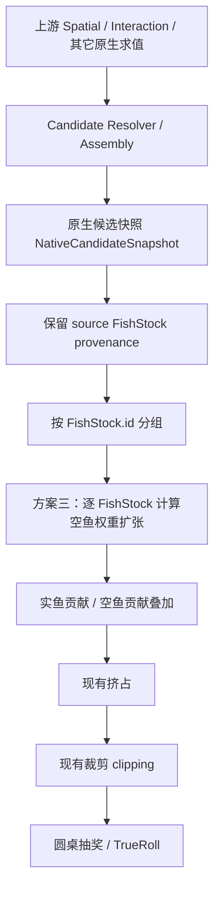
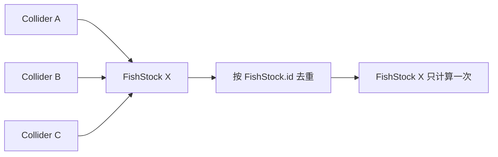

# 方案三｜实鱼总权重锚点与空鱼权重扩张｜开发需求

> **Document Role：** Development Specification  
> **Status：** Working / Candidate  
> **Version：** v0.2  
> **Last Updated：** 2026-10-15（Asia/Taipei）  
> **Scope：** 权重池（FishStock）/ 空鱼权重扩张 / 区域权重池叠加  
> **Authority：** 本文是本期局部开发规格，不覆盖「中鱼升级」Mainline Current。原生候选（Native Candidate）、TrueRoll、交验与服务端权威等跨域边界，以 Router 当前指向的 Current 为准。

本文只回答：**方案三如何配置、在运行链的哪一步计算、多个区域权重池如何叠加、以及如何与现有挤占和裁剪衔接。**

本文不负责回答 `real_fish_weight_anchor` 与 `none_fish_weight_expansion_rate` 应该配置成多少，也不展开卧龙（Wolong）配置校验；这部分另写《权重池参数配置与校验指导》。

本版本暂不处理交验、服务端权威与跨端一致性改造，后续统一处理。

---

## 0. 一分钟摘要

方案三包含两个相互关联、但应分别理解的改动。

### 改动 A｜实鱼总权重过高时扩张空鱼权重

每个权重池（`FishStock`）在已有 `none_fish_weight` 基础上新增：

| 字段 | 中文名 | 类型 | 默认值 |
|---|---|---:|---:|
| `real_fish_weight_anchor` | 实鱼总权重锚点 | `INT32` | `0` |
| `none_fish_weight_expansion_rate` | 空鱼权重扩张率 | `FLOAT` | `0.0` |

对权重池 $k$：

$$
W_{\Sigma,k}=\sum_i W_{i,k}
$$

$$
X_k=\max(0,W_{\Sigma,k}-A_k)
$$

$$
E_{e,k}=E_{0,k}+S_kX_k
$$

其中：

- $W_{\Sigma,k}$：实鱼总权重；
- $A_k$：实鱼总权重锚点；
- $E_{0,k}$：基础空鱼权重；
- $S_k$：空鱼权重扩张率；
- $E_{e,k}$：扩张后空鱼权重。

`S = 0` 时，**仅对改动 A 而言**，扩张后空鱼权重仍等于原基础空鱼权重。

### 改动 B｜区域权重池叠加时，空鱼权重也叠加

历史逻辑中，局部权重池（LocalStock）的实鱼会参与叠加，但其空鱼权重不生效。

本期改为：

$$
E_{\text{stack}}=\sum_k E_{e,k}
$$

也就是：**每个有效 FishStock 同时携带自己的实鱼贡献和空鱼贡献。**

> 因此，`A=0 / S=0` 只能保证“新增扩张公式本身”不改变旧行为；LocalStock 空鱼开始参与叠加，是本期明确引入的另一项行为变化。

### 运行顺序

```text
上游原生候选求值
→ 原生候选闭合（保留 source FishStock provenance）
→ 按 FishStock.id 去重 / 分组
→ 每个 FishStock 计算空鱼权重扩张
→ 各 FishStock 的实鱼贡献与空鱼贡献叠加
→ 现有挤占
→ 现有裁剪（clipping）
→ 圆桌抽奖 / TrueRoll
```

方案三不修改任意单鱼实鱼权重，也不替代现有挤占与裁剪。

---

# 1. 背景与目标

当前权重体系有一个合理的基本反馈：

```text
单鱼实鱼权重提高
→ 实鱼总权重提高
→ 抽到任意鱼的概率提高
→ 中鱼更快
```

这个方向应当保留。

问题发生在上侧：当同一个权重池中多条鱼同时拥有较高权重，或者多个区域权重池同时生效时，实鱼总权重可能显著增长。如果空鱼侧完全不随之调整，“中任意鱼”的效率可能增长过快，压缩正常作钓节奏。

方案三只解决这个窄问题：

> **当某个 FishStock 的实鱼总权重超过配置锚点后，按超额部分扩张该 FishStock 的空鱼权重，使更高的实鱼总权重仍然有价值，但不必继续完全线性地兑换成“中任意鱼”的加速。**

方案三属于**权重池级节奏整形**。它不重新解释某条鱼为什么权重高，也不负责目标鱼 / 保底鱼分类、鱼类习性、Bake、Response 等上游语义。

---

# 2. 概念与符号

| 中文概念 | 英文名词 | 含义 | 数学表示 | KaTeX |
|---|---|---|---|---|
| **权重池** | Weight Pool / FishStock | 本需求的配置和计算单位。当前生产表中由 `FishStock` 承载。 | $k$ | `k` |
| **局部权重池** | Local Weight Pool / LocalStock | 由区域命中后附加生效的 FishStock。 | — | — |
| **实鱼权重** | Real Fish Weight | 单条候选鱼完成上游原生求值后，对当前权重池贡献的实鱼权重。 | $W_{i,k}$ | `W_{i,k}` |
| **实鱼总权重** | Total Real Fish Weight | 某个 FishStock 内有效实鱼权重之和。 | $W_{\Sigma,k}$ | `W_{\Sigma,k}=\sum_i W_{i,k}` |
| **基础空鱼权重** | Base No-Fish Weight | FishStock 已配置的 `none_fish_weight`。 | $E_{0,k}$ | `E_{0,k}` |
| **实鱼总权重锚点** | Real Fish Weight Anchor | 实鱼总权重超过该值后开始扩张空鱼权重。 | $A_k$ | `A_k` |
| **超额实鱼权重** | Excess Real Fish Weight | 实鱼总权重超过锚点的部分。 | $X_k$ | `X_k=\max(0,W_{\Sigma,k}-A_k)` |
| **空鱼权重扩张率** | No-Fish Weight Expansion Rate | 每 1 单位超额实鱼权重带来多少单位新增空鱼权重。 | $S_k$ | `S_k` |
| **扩张后空鱼权重** | Expanded No-Fish Weight | 单个 FishStock 执行方案三后的空鱼权重。 | $E_{e,k}$ | `E_{e,k}=E_{0,k}+S_kX_k` |
| **叠加空鱼权重** | Stacked No-Fish Weight | 所有有效 FishStock 的扩张后空鱼权重之和。 | $E_{\text{stack}}$ | `E_{\text{stack}}=\sum_kE_{e,k}` |
| **原生候选快照** | NativeCandidateSnapshot | 上游原生候选完成合法闭合后的候选表面。方案三只能发生在其之后。 | — | — |

本文后续统一使用“**空鱼权重扩张**”。“补偿”“膨胀”只作为自然语言解释，不作为另一套正式术语。

---

# 3. 核心机制

## 3.1 单个 FishStock

对权重池 $k$，在原生候选已经闭合、且仍能识别其 `source FishStock` 的前提下，统计该池贡献的所有实鱼权重：

$$
W_{\Sigma,k}=\sum_i W_{i,k}
$$

超额实鱼权重为：

$$
X_k=\max(0,W_{\Sigma,k}-A_k)
$$

扩张后空鱼权重为：

$$
E_{e,k}=E_{0,k}+S_kX_k
$$

直观上：

```text
实鱼总权重 ≤ 锚点
→ 只使用基础空鱼权重

实鱼总权重 > 锚点
→ 只对超过锚点的部分计算额外空鱼权重
```

方案三**不修改** $W_{i,k}$。

因此，方案三自身不会改变同一批实鱼之间的相对权重。

## 3.2 多个 FishStock

假设本次有效权重池集合为：

```text
基础权重池
+ 局部权重池 A
+ 局部权重池 B
```

每个 FishStock 先独立计算自己的 $E_{e,k}$，之后再叠加：

$$
E_{\text{stack}}=\sum_k E_{e,k}
$$

实鱼侧继续沿用现有权重池拼接 / 聚合规则。

这样不需要发明“多个 FishStock 的 Anchor 怎么合”“多个扩张率怎么平均”等跨池规则：**每个 FishStock 只解释自己的配置，最终只叠加贡献。**

---

# 4. 运行时契约

## 4.1 架构边界

方案三是原生候选闭合后的节奏整形，不属于原生候选求值本身。

语义顺序固定为：



若阅读器不支持 Mermaid：

```text
上游原生求值
→ Candidate Resolver / Assembly
→ NativeCandidateSnapshot 闭合
→ 按 source FishStock 分组
→ 方案三
→ 多池叠加
→ 挤占
→ 裁剪
→ 圆桌抽奖
```

### 关键要求：不能过早丢失来源池信息

原生候选闭合后，至少到方案三计算结束前，运行时必须能够回答：

> 某一份最终实鱼权重贡献来自哪个 `FishStock.id`？

实现不要求必须保留独立行表，也不要求存在名为 `CandidateResolver` 或 `FishStockAccumulator` 的类。

只要求语义上能够恢复：

```text
FishStock.id
→ 本池实鱼权重贡献
→ 本池 E0 / A / S
```

否则无法按每个 FishStock 自己的参数执行方案三。

## 4.2 去重单位

权重池去重键固定为：

```text
FishStock.id
```

一个逻辑区域可能由多个 Collider / Trigger 表达。如果这些空间对象都指向同一个 `FishStock.id`，则该 FishStock 只参与一次。



反之，如果空间上同时命中多个不同的 `FishStock.id`，则它们是多个独立权重池，全部参与叠加。

> **空间切片方式不能凭空复制同一个权重池；不同 FishStock.id 则代表明确的独立权重池。**

## 4.3 运行步骤

```text
1. 得到本次有效 FishStock.id 集合并去重

2. NativeCandidateSnapshot 闭合
   - 保留足够的 source FishStock provenance

3. 对每个 FishStock k：
   WΣ,k = Σ Wi,k
   Xk   = max(0, WΣ,k - Ak)
   Ee,k = E0,k + Sk × Xk

4. 叠加：
   - 实鱼：沿用现有实鱼拼接 / 聚合规则
   - 空鱼：Estack = Σ Ee,k

5. 执行现有挤占

6. 执行现有裁剪（clipping）

7. 进入现有圆桌抽奖 / TrueRoll
```

---

# 5. FishStock 配置变更

现有 `FishStock` 已承载 `none_fish_weight`，因此新增字段与其保持同作用域。

建议字段排列：

```text
FishStock
├─ id
├─ name
├─ reset_day_time
├─ none_fish_weight
├─ real_fish_weight_anchor              ← 新增
├─ none_fish_weight_expansion_rate      ← 新增
├─ max_time_multiplier
└─ time_expect_factor
```

字段定义：

| 字段 | 中文名 | 类型 | 默认值 | 运行时用途 |
|---|---|---|---|---|
| `none_fish_weight` | 基础空鱼权重 | 沿用现有类型 | 沿用现有值 | $E_0$ |
| `real_fish_weight_anchor` | 实鱼总权重锚点 | `INT32` | `0` | $A$ |
| `none_fish_weight_expansion_rate` | 空鱼权重扩张率 | `FLOAT` | `0.0` | $S$ |

## 5.1 默认值只关闭“扩张公式”

当：

```text
none_fish_weight_expansion_rate = 0
```

则：

$$
E_e=E_0
$$

所以新增字段默认 `A=0, S=0` 时，**方案三的扩张公式本身不改变该 FishStock 的空鱼权重。**

但这不等于整个版本完全保持旧行为，因为本期同时修改了 LocalStock 空鱼权重的叠加规则，见下一章。

## 5.2 数值类型与取整

本期约定：

```text
real_fish_weight_anchor
→ INT32

none_fish_weight_expansion_rate
→ FLOAT
```

方案三自身不新增 floor / ceil / round。

$$
E_{e,k}=E_{0,k}+S_kX_k
$$

允许在中间过程得到浮点结果。

进入现有圆桌数值边界时，继续沿用现有权重数值规范；如果现有圆桌要求整数，只在既有边界统一转换，不在每个 FishStock 内反复取整。

---

# 6. 区域权重池规则变化与迁移

## 6.1 历史行为

历史《中鱼0.2.2.3+-权重池拆分》中：

- 基础权重池与命中的局部权重池会叠加实鱼贡献；
- 同一鱼品质 / 候选可以按既有规则保留来自多个池的贡献；
- LocalStock 的空鱼权重不参与最终空鱼。

## 6.2 本期行为

本期改为：

> **所有有效 FishStock 的空鱼贡献都参与叠加。**

即：

$$
E_{\text{stack}}=\sum_kE_{e,k}
$$

一个权重池从此同时携带：

```text
实鱼贡献
+
空鱼贡献
```

而不再只有实鱼贡献。

## 6.3 这是独立的行为变化

必须区分：

**扩张公式兼容性**

```text
S = 0
→ Ee = E0
```

与：

**区域池空鱼叠加变化**

```text
旧：
LocalStock.none_fish_weight 不生效

新：
LocalStock.none_fish_weight 进入 Estack
```

因此旧数据迁移不能只写成“补 0 / 0 即完全兼容”。

开发 / 数据迁移需要显式处理两件事：

```text
新增字段：
real_fish_weight_anchor = 0
none_fish_weight_expansion_rate = 0.0

历史 LocalStock.none_fish_weight：
从“历史上不生效的数据”变成“新版本会生效的数据”
→ 需要纳入迁移核对
```

本文不规定各 LocalStock 最终应该配置成多少；具体值与 Wolong 校验由独立配置指导负责。

Runtime 不应为了模拟旧逻辑而自动忽略 LocalStock 的 `none_fish_weight`。

---

# 7. 与现有挤占、裁剪的关系

方案三不替代现有挤占，也不删除现有裁剪。

执行顺序固定为：

```text
空鱼权重扩张
→ 多 FishStock 叠加
→ 现有挤占
→ 现有裁剪
→ 圆桌抽奖
```

现有挤占仍负责其原有职责，包括保持收益期望与权重调整之间的可预估性 / 可调性。

现有裁剪当前与方案三不冲突，即使在现有数据下可能较少触发，本期也不修改或删除，避免把无关的 Legacy 清理绑进本需求。

---

# 8. 边界行为

## 8.1 锚点以下

当：

$$
W_{\Sigma,k}\le A_k
$$

则：

$$
E_{e,k}=E_{0,k}
$$

方案三不额外扩张空鱼。

## 8.2 扩张率为 0

当：

$$
S_k=0
$$

则：

$$
E_{e,k}=E_{0,k}
$$

无论实鱼总权重多高，该 FishStock 都不执行额外扩张。

## 8.3 FishStock 当前没有实鱼贡献

当：

$$
W_{\Sigma,k}=0
$$

如果这个 FishStock 本次仍是一个有效命中的权重池，则：

$$
E_{e,k}=E_{0,k}
$$

也就是说：

> **有效权重池即使当前没有任何实鱼贡献，只要它配置了基础空鱼权重，仍会向叠加池贡献空鱼权重。**

这与“FishStock 同时携带实鱼贡献与空鱼贡献”的新语义一致。

## 8.4 多个空间对象命中同一 FishStock

按 `FishStock.id` 去重，只计算一次。

## 8.5 多个不同 FishStock 空间重叠

全部生效，各自计算后叠加。

---

# 9. 示例

以下数字只用于解释运行过程，不作为配置建议。

假设当前有效权重池为：

| 权重池 | 实鱼总权重 $W_\Sigma$ | 基础空鱼 $E_0$ | 锚点 $A$ | 扩张率 $S$ |
|---|---:|---:|---:|---:|
| 基础权重池 | 120 | 100 | 100 | 0.5 |
| 局部权重池 A | 70 | 60 | 50 | 0.5 |
| 局部权重池 B | 40 | 20 | 60 | 0.5 |

基础权重池：

$$
X=120-100=20
$$

$$
E_e=100+0.5\times20=110
$$

局部权重池 A：

$$
X=70-50=20
$$

$$
E_e=60+0.5\times20=70
$$

局部权重池 B：

$$
X=\max(0,40-60)=0
$$

$$
E_e=20
$$

因此：

$$
E_{\text{stack}}=110+70+20=200
$$

计算表：

| 权重池 | $W_\Sigma$ | $X$ | $E_0$ | $S$ | $E_e$ |
|---|---:|---:|---:|---:|---:|
| 基础权重池 | 120 | 20 | 100 | 0.5 | 110 |
| 局部权重池 A | 70 | 20 | 60 | 0.5 | 70 |
| 局部权重池 B | 40 | 0 | 20 | 0.5 | 20 |
| **叠加结果** | **230** | — | — | — | **200** |

之后继续：

```text
实鱼贡献 + 空鱼 200
→ 现有挤占
→ 现有裁剪
→ 圆桌抽奖
```

---

# 10. 调试、测试与验收

## 10.1 建议调试输出

单个 FishStock 至少应能观测：

| 字段 | 含义 |
|---|---|
| `fish_stock_id` | 当前权重池身份，也是去重键 |
| `real_fish_weight_total` | $W_{\Sigma,k}$ |
| `base_none_fish_weight` | $E_{0,k}$ |
| `real_fish_weight_anchor` | $A_k$ |
| `none_fish_weight_expansion_rate` | $S_k$ |
| `excess_real_fish_weight` | $X_k$ |
| `expanded_none_fish_weight` | $E_{e,k}$ |

叠加级至少应能观测：

```text
effective_fish_stock_ids
stacked_real_fish_weight
stacked_none_fish_weight
```

为区分后续既有机制影响，调试 / 模拟环境建议能看到：

```text
before_squeeze
after_squeeze
after_clipping
roundtable_input
```

## 10.2 最小测试集

| Case | 输入 / 场景 | 关键期望 |
|---|---|---|
| 单池：低于锚点 | $W_\Sigma<A$ | $E_e=E_0$ |
| 单池：等于锚点 | $W_\Sigma=A$ | $E_e=E_0$ |
| 单池：高于锚点 | $W_\Sigma>A$ | $E_e=E_0+S(W_\Sigma-A)$ |
| 扩张关闭 | $S=0$ | $E_e=E_0$ |
| 无实鱼贡献 | $W_\Sigma=0$，FishStock 有效 | 仍贡献 $E_0$ |
| 基础池 + 1 LocalStock | 两个不同 FishStock.id | 两个空鱼贡献都叠加 |
| 基础池 + 多 LocalStock | 多个不同 FishStock.id | $E_{\text{stack}}=\sum E_e$ |
| Collider 重复命中 | 多个 Collider 指向同一 FishStock.id | 只计算一次 |
| 空间重叠 | 命中多个不同 FishStock.id | 各自计算并叠加 |
| 顺序检查 | 固定 Fixture | 扩张 → 叠加 → 挤占 → 裁剪 → 圆桌 |
| 实鱼保真 | 同一 Native 输入 | 方案三阶段不修改任意 $W_{i,k}$ |

另外需要一组迁移回归：

> LocalStock 历史上已有非零 `none_fish_weight` 时，新版本应明确验证这些值开始生效后的结果，而不是把 `S=0` 误判为“整套旧行为不变”。

---

# 11. 本版本不处理

本开发需求不展开以下内容：

- `real_fish_weight_anchor` 应如何配置；
- `none_fish_weight_expansion_rate` 应如何配置；
- 参数推荐范围与体验标定；
- 参数组合的数学约束；
- 卧龙（Wolong）Warning / Error 校验；
- 服务端 authoritative replay；
- Client / Server 配置版本对齐；
- RNG / replay payload；
- 现有挤占公式的重设计；
- 现有裁剪算法的重设计。

这些内容由独立配置指导或对应 Current / 后续需求处理。

---

# 12. 实现摘要

最终实现契约可以压缩为：

$$
W_{\Sigma,k}=\sum_iW_{i,k}
$$

$$
X_k=\max(0,W_{\Sigma,k}-A_k)
$$

$$
E_{e,k}=E_{0,k}+S_kX_k
$$

$$
E_{\text{stack}}=\sum_kE_{e,k}
$$

并满足：

```text
NativeCandidateSnapshot 已闭合
→ 保留 source FishStock provenance
→ 按 FishStock.id 去重 / 分组
→ 每 FishStock 独立扩张空鱼权重
→ 实鱼 / 空鱼叠加
→ 现有挤占
→ 现有裁剪
→ 圆桌抽奖
```

核心原则：

> **每个 FishStock 自己解释自己的实鱼规模和空鱼参数；区域权重池叠加时，实鱼贡献和空鱼贡献一起叠加。方案三只扩张空鱼，不改写原生实鱼权重，并完整保留后续既有挤占与裁剪。**
