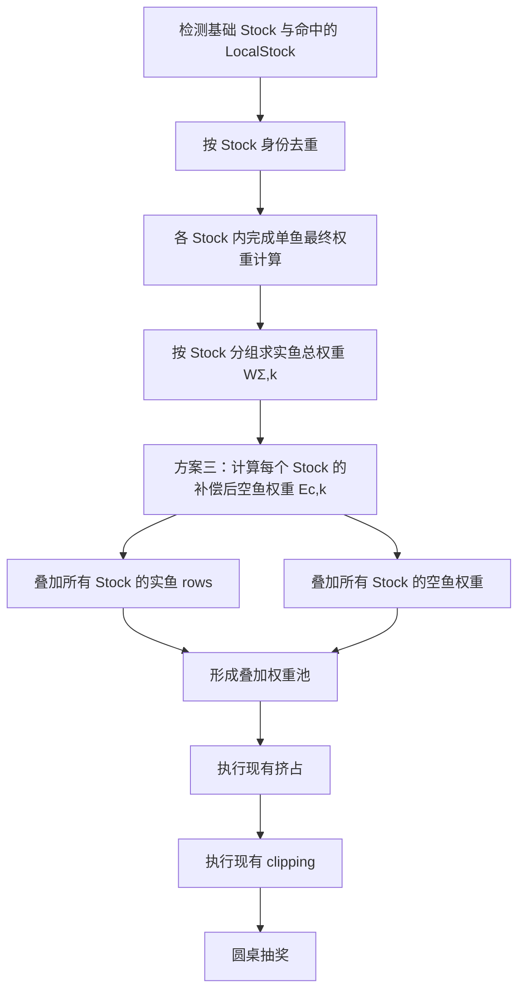
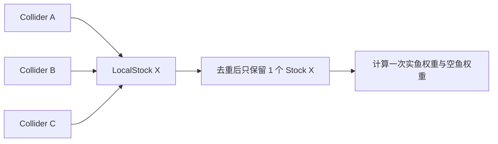
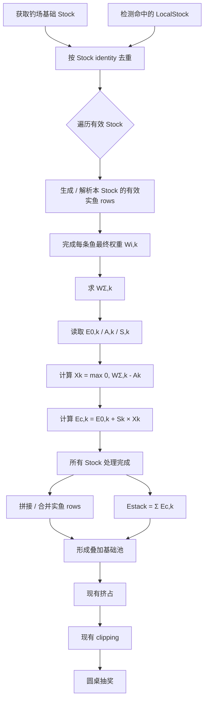

# 方案三｜实鱼总权重锚点与空鱼权重扩张｜开发需求

> **文档状态：开发需求草案**
>
> 本文描述方案三的运行逻辑、FishStock 配置改动、区域权重池叠加、与现有挤占 / clipping 的执行顺序，以及调试与测试要求。
>
> 本文**不负责**说明 `real_fish_weight_anchor` 与 `none_fish_weight_expansion_rate` 应该配置成多少，也不展开 Wolong 配置校验规则；相关内容另写《权重池参数配置与校验指导》。
>
> 本版本暂不处理交验、服务端权威与跨端一致性改造，后续统一处理。

---

## 0. 本期改动摘要

本期只在现有权重池流程上增加一层**空鱼权重补偿**，并修正区域权重池叠加时的空鱼权重合并规则。

### 配置改动

`FishStock` 在现有 `none_fish_weight` 基础上新增两列：

| 字段 | 中文名 | 类型 | 默认值 |
|---|---|---:|---:|
| `none_fish_weight` | 基础空鱼权重 | 现有类型 | 现有值 |
| `real_fish_weight_anchor` | 实鱼总权重锚点 | `INT32` | `0` |
| `none_fish_weight_expansion_rate` | 空鱼权重扩张率 | `FLOAT` | `0.0` |

### Runtime 改动

对每一个有效 `FishStock`：

\[
W_{\Sigma,k}=\sum_i W_{i,k}
\]

\[
X_k=\max(0,W_{\Sigma,k}-A_k)
\]

\[
E_{c,k}=E_{0,k}+S_kX_k
\]

多个 `FishStock` 叠加时：

\[
E_{\text{stack}}=\sum_k E_{c,k}
\]

之后继续执行现有：

```text
挤占
→ clipping
→ 圆桌抽奖
```

### 不改的部分

- 不修改任意单鱼最终实鱼权重；
- 不修改鱼种之间的相对权重；
- 不替代现有挤占逻辑；
- 不删除现有 clipping；
- 不新增“目标鱼 / 保底鱼”Runtime 标签；
- 不要求逐鱼计算“权重释放度”。

---

# 1. 背景与目标

## 1.1 当前问题

当前权重体系具有一个合理但存在上侧风险的性质：

```text
单鱼实鱼权重提高
→ 实鱼总权重提高
→ 抽到任意鱼的概率提高
→ 中鱼更快
```

单条鱼因为环境、空间、饵、钓组等因素变得更容易中，是我们希望保留的反馈。

问题在于：当多个权重池叠加、或多条鱼同时具有较高权重时，**实鱼总权重可能显著增加**。如果空鱼权重没有随之得到控制，总体鱼口可能被放大得过快。

方案三只处理这一件事：

> **当一个 FishStock 的实鱼总权重超过其配置锚点后，按超额部分增加空鱼权重，使实鱼总量继续增长时仍能带来更旺的鱼口，但不必完全线性兑换成“中任意鱼”的加速。**

## 1.2 设计边界

方案三属于**权重池级节奏整形**。

它不重新解释：

- 某条鱼为什么权重高；
- 某个环境系数是否合理；
- 哪些鱼是目标鱼；
- 哪些鱼是保底鱼；
- 哪个 Response 应该是多少。

这些仍由上游机制产生。

方案三只消费已经形成的最终实鱼权重，并对空鱼侧做处理。

---

# 2. 概念与符号

正式文档先建立中文概念，再给英文名词和数学表示。

| 中文概念 | 英文名词 | 含义 | 数学表示 | KaTeX |
|---|---|---|---|---|
| **权重池** | Weight Pool | 一组参与同一次中鱼权重计算的实鱼权重与空鱼权重。当前生产配置中由 `FishStock` 承载。 | — | — |
| **实鱼权重** | Real Fish Weight | 单条候选鱼经过上游计算后，准备进入后续权重池流程的最终权重。 | \(W_{i,k}\) | `W_{i,k}` |
| **实鱼总权重** | Total Real Fish Weight | 某个 FishStock 内全部有效实鱼权重之和。 | \(W_{\Sigma,k}\) | `W_{\Sigma,k}=\sum_i W_{i,k}` |
| **基础空鱼权重** | Base No-Fish Weight | FishStock 配置的原始空鱼权重。 | \(E_{0,k}\) | `E_{0,k}` |
| **实鱼总权重锚点** | Real Fish Weight Anchor | FishStock 内实鱼总权重超过该值后，开始增加额外空鱼权重。 | \(A_k\) | `A_k` |
| **超额实鱼权重** | Excess Real Fish Weight | 实鱼总权重超过锚点的部分。 | \(X_k\) | `X_k=\max(0,W_{\Sigma,k}-A_k)` |
| **空鱼权重扩张率** | No-Fish Weight Expansion Rate | 每增加 1 单位超额实鱼权重，需要增加多少单位空鱼权重。 | \(S_k\) | `S_k` |
| **补偿后空鱼权重** | Compensated No-Fish Weight | 单个 FishStock 执行方案三后、进入多池叠加前的空鱼权重。 | \(E_{c,k}\) | `E_{c,k}=E_{0,k}+S_kX_k` |
| **叠加空鱼权重** | Stacked No-Fish Weight | 所有有效 FishStock 的补偿后空鱼权重之和。 | \(E_{\text{stack}}\) | `E_{\text{stack}}=\sum_k E_{c,k}` |

> **命名说明**
>
> 本文使用“补偿后空鱼权重”，不称“最终空鱼权重”，因为后续仍需要执行现有挤占与 clipping。

---

# 3. 机制总览

## 3.1 一张图先看完整流程



若当前 Markdown 阅读器不支持 Mermaid，可按下列顺序理解：

```text
有效 FishStock
    ↓
按 Stock 去重
    ↓
各 Stock 内完成实鱼权重计算
    ↓
每个 Stock 单独计算空鱼补偿
    ↓
实鱼 + 空鱼分别叠加
    ↓
现有挤占
    ↓
现有 clipping
    ↓
圆桌抽奖
```

---

# 4. FishStock 配置改动

## 4.1 配置对象

方案三的配置单位是：

> **FishStock**

原因是现有权重池已经由 `FishStock` 承载，且 `none_fish_weight` 已经属于该对象。

方案三新增的两个字段应与 `none_fish_weight` 保持相同作用域。

建议字段排列：

```text
FishStock
├─ id
├─ name
├─ reset_day_time
├─ none_fish_weight
├─ real_fish_weight_anchor              ← 新增
├─ none_fish_weight_expansion_rate      ← 新增
├─ max_time_multiplier
└─ time_expect_factor
```

## 4.2 字段定义

| 字段 | 中文名 | 类型 | 默认值 | Runtime 用途 |
|---|---|---|---|---|
| `none_fish_weight` | 基础空鱼权重 | 沿用现有类型 | 沿用现有值 | \(E_0\) |
| `real_fish_weight_anchor` | 实鱼总权重锚点 | `INT32` | `0` | \(A\) |
| `none_fish_weight_expansion_rate` | 空鱼权重扩张率 | `FLOAT` | `0.0` | \(S\) |

### 默认值语义

当：

```text
none_fish_weight_expansion_rate = 0
```

时：

\[
E_c=E_0
\]

因此方案三不会改变旧数据行为。

旧配置迁移时建议显式补齐：

```text
real_fish_weight_anchor = 0
none_fish_weight_expansion_rate = 0.0
```

而不是让 Runtime 依赖“字段缺失”来猜测默认语义。

> 参数合法范围、推荐值、参数之间的约束及 Wolong 校验，放在独立配置指导文档中，不在本文展开。

---

# 5. 单个 FishStock 如何计算

## 5.1 输入

对 FishStock \(k\)，先完成该 Stock 内所有单鱼的正常上游权重计算。

得到：

\[
W_{1,k},W_{2,k},...,W_{n,k}
\]

方案三不参与这些权重的生成。

## 5.2 求实鱼总权重

\[
\boxed{
W_{\Sigma,k}=\sum_i W_{i,k}
}
\]

这里的权重必须是：

> **方案三执行前，真正准备进入后续权重池流程的有效实鱼权重。**

不使用：

- 基础权重；
- Bake 中间值；
- Response 中间值；
- 尚未完成合法性处理的 Candidate。

## 5.3 求超额实鱼权重

\[
\boxed{
X_k=\max(0,W_{\Sigma,k}-A_k)
}
\]

当：

\[
W_{\Sigma,k}\le A_k
\]

则：

\[
X_k=0
\]

方案三不额外增加空鱼权重。

## 5.4 求补偿后空鱼权重

\[
\boxed{
E_{c,k}=E_{0,k}+S_kX_k
}
\]

展开为：

\[
\boxed{
E_{c,k}
=
E_{0,k}
+
S_k\max(0,W_{\Sigma,k}-A_k)
}
\]

### 直观解释

```text
锚点以内
→ 只使用原有空鱼权重

超过锚点
→ 超出多少实鱼权重
× S
→ 增加多少空鱼权重
```

## 5.5 不修改实鱼

方案三只计算 \(E_{c,k}\)。

它不执行：

\[
W_{i,k}\rightarrow W'_{i,k}
\]

因此单个 Stock 内各实鱼之间的相对关系保持不变。

---

# 6. 多个区域权重池如何叠加

## 6.1 历史规则

历史《中鱼0.2.2.3+-权重池拆分》中：

- 钓场基础池与命中的 LocalStock 会拼接实鱼 rows；
- 相同 `fish_quality` 可以在不同池重复出现；
- **空鱼权重只保留钓场全局池，LocalStock 的空鱼权重不生效。**

本需求修改其中最后一条：

> **区域权重池叠加时，空鱼权重也必须随 FishStock 一起叠加。**

其它已有实鱼拼接 / 合并行为，本期不主动改造。

## 6.2 新规则

假设本次命中：

```text
基础 Stock
LocalStock A
LocalStock B
```

三个 Stock 分别先完成自己的方案三计算：

```text
基础 Stock     → Ec,base
LocalStock A   → Ec,A
LocalStock B   → Ec,B
```

最终叠加：

\[
\boxed{
E_{\text{stack}}
=
E_{c,\text{base}}
+
E_{c,A}
+
E_{c,B}
}
\]

一般形式：

\[
\boxed{
E_{\text{stack}}
=
\sum_k
\left[
E_{0,k}
+
S_k\max(0,W_{\Sigma,k}-A_k)
\right]
}
\]

实鱼侧仍按现有规则叠加：

\[
\boxed{
\text{FishRows}_{\text{stack}}
=
\bigcup_k \text{FishRows}_k
}
\]

这里的“并集”表达逻辑拼接，不要求实现层一定使用集合数据结构。

---

# 7. 为什么必须按 FishStock 分别计算，再叠加空鱼

不能先把多个 Stock 合成一份后，再尝试合并：

- Anchor；
- Expansion Rate；
- Base No-Fish Weight。

否则会出现没有清晰语义的问题：

```text
两个 Stock 的 Anchor 怎么合？
取和？
取最大值？
平均？
```

方案三直接避免这个问题：

```text
每个 Stock 只解释自己的参数
→ 独立得到 Ec,k
→ 最后只做加法
```

因此 `A` 与 `S` 永远不需要跨 Stock 合并。

---

# 8. Stock 去重：空间切片不能重复制造权重

历史 LocalStock 允许用多个 Collider / Trigger 表达同一个逻辑区域。

例如一个凹形区域可能由多个 Box 拼成：

```text
Box 1 ─┐
Box 2 ─┼─→ stock_watergrass_01
Box 3 ─┘
```

如果一次抛投同时命中三个 Box，它们仍然只是**一个 FishStock**。

必须：

```text
命中的区域对象
→ 按 Stock identity 去重
→ 再进入权重计算
```

不能：

```text
3 个 Collider
→ 同一 Stock 计算 3 次
```

否则会同时造成：

```text
实鱼权重 × 3
空鱼权重 × 3
```

### 图示



---

# 9. 与现有挤占、clipping 的执行顺序

方案三**不替代**现有挤占，也**不删除** clipping。

当前顺序约定为：

```text
① 单鱼最终权重计算
② 每个 Stock 的空鱼权重补偿
③ 多 Stock 叠加
④ 现有挤占
⑤ 现有 clipping
⑥ 圆桌抽奖
```

## 9.1 为什么方案三在挤占前

本期新增逻辑先决定：

> 这个权重池在当前实鱼规模下，应当提供多少空鱼权重。

之后再让既有挤占机制继续处理收益期望、权重与最终结果之间的关系。

因此：

```text
先补偿 / 膨胀空鱼
→ 再走原有挤占
```

## 9.2 clipping 不改

clipping 当前与方案三没有直接冲突。

即使在现有数据下可能很少触发，也不在本需求中删除或重定义：

> 保留既有 clipping 作为后续流程的一部分。

这样未来即使方案三参数或机制继续变化，也不会因为本期顺手删除旧保护逻辑而增加额外风险。

---

# 10. Runtime 完整顺序

## 10.1 流程图



## 10.2 纯文本版本

```text
钓场基础 Stock
+ 命中的 LocalStock
        ↓
Stock identity 去重
        ↓
对每个 Stock：
    解析有效实鱼 rows
        ↓
    得到最终 W_i,k
        ↓
    WΣ,k = ΣW_i,k
        ↓
    Ec,k = E0,k + S_k × max(0, WΣ,k-A_k)
        ↓
所有 Stock 完成
        ↓
实鱼 rows 叠加
空鱼 Ec,k 叠加
        ↓
现有挤占
        ↓
现有 clipping
        ↓
圆桌抽奖
```

---

# 11. 数值类型与取整

## 11.1 配置类型

本期约定：

```text
real_fish_weight_anchor
→ INT32

none_fish_weight_expansion_rate
→ FLOAT
```

## 11.2 方案三本身不新增取整

计算：

\[
E_{c,k}
=
E_{0,k}+S_kX_k
\]

允许得到浮点结果。

方案三内部不要求：

- floor；
- ceil；
- round；
- 每个 Stock 单独量化。

原则：

> **保持连续值计算，到现有圆桌数值边界时，沿用圆桌当前已有的权重数值规范。**

如果现有圆桌支持浮点累计权重，则直接使用。

如果现有圆桌必须使用整数，则只在进入该既有边界时按统一规则转换，不在方案三中重复增加一套取整政策。

---

# 12. 示例：基础池 + 两个区域池

> 以下数字只用于解释运行过程，不代表配置建议。

假设命中三个 Stock：

| Stock | 实鱼总权重 \(W_\Sigma\) | 基础空鱼 \(E_0\) | 锚点 \(A\) | 扩张率 \(S\) |
|---|---:|---:|---:|---:|
| 基础 Stock | 120 | 100 | 100 | 0.5 |
| LocalStock A | 70 | 30 | 50 | 1.0 |
| LocalStock B | 40 | 20 | 60 | 0.5 |

### Step 1：分别计算超额

基础 Stock：

\[
X=120-100=20
\]

LocalStock A：

\[
X=70-50=20
\]

LocalStock B：

\[
X=\max(0,40-60)=0
\]

### Step 2：分别计算补偿后空鱼

基础 Stock：

\[
E_c=100+0.5\times20=110
\]

LocalStock A：

\[
E_c=30+1.0\times20=50
\]

LocalStock B：

\[
E_c=20
\]

### Step 3：叠加空鱼

\[
E_{\text{stack}}=110+50+20=180
\]

然后：

```text
实鱼 rows 叠加
+ 空鱼权重 180
        ↓
现有挤占
        ↓
现有 clipping
        ↓
圆桌
```

### 计算表

| Stock | \(W_\Sigma\) | \(X\) | \(E_0\) | \(S\) | \(E_c\) |
|---|---:|---:|---:|---:|---:|
| 基础 Stock | 120 | 20 | 100 | 0.5 | 110 |
| LocalStock A | 70 | 20 | 30 | 1.0 | 50 |
| LocalStock B | 40 | 0 | 20 | 0.5 | 20 |
| **叠加** | **230** | — | — | — | **180** |

---

# 13. 伪代码

以下只表达语义，不要求程序采用同名类或数据结构。

```text
effectiveStocks =
    ResolveBaseAndLocalStocks()

effectiveStocks =
    DistinctByStockIdentity(effectiveStocks)

stackedFishRows = []
stackedCompensatedNoneFishWeight = 0.0

for stock in effectiveStocks:

    fishRows =
        ResolveFinalFishRows(stock)

    realFishWeightTotal =
        Sum(row.finalWeight for row in fishRows)

    baseNoneFishWeight =
        stock.noneFishWeight

    anchor =
        stock.realFishWeightAnchor

    expansionRate =
        stock.noneFishWeightExpansionRate

    excessRealFishWeight =
        Max(
            0,
            realFishWeightTotal - anchor
        )

    compensatedNoneFishWeight =
        baseNoneFishWeight
        + expansionRate * excessRealFishWeight

    stackedFishRows.Append(fishRows)

    stackedCompensatedNoneFishWeight +=
        compensatedNoneFishWeight


stackedPool =
    BuildStackedPool(
        stackedFishRows,
        stackedCompensatedNoneFishWeight
    )

stackedPool =
    ApplyExistingSqueeze(stackedPool)

stackedPool =
    ApplyExistingClipping(stackedPool)

return RoundtableRoll(stackedPool)
```

---

# 14. 必须保持的行为

## 14.1 单鱼权重不因方案三改变

对任意鱼：

\[
W_{i,k}^{\text{before}}
=
W_{i,k}^{\text{after scheme 3}}
\]

方案三只增加空鱼侧。

## 14.2 鱼与鱼之间的相对权重不因方案三改变

若同一阶段还没有执行其它会改变实鱼权重的既有逻辑，则方案三本身满足：

\[
\frac{W_i}{W_j}
\]

保持不变。

## 14.3 锚点以下不增加空鱼

当：

\[
W_{\Sigma,k}\le A_k
\]

则：

\[
E_{c,k}=E_{0,k}
\]

## 14.4 Expansion Rate 为 0 时保持旧行为

当：

\[
S_k=0
\]

则：

\[
E_{c,k}=E_{0,k}
\]

因此新增字段默认 `0 / 0.0` 时，不改变旧 Stock 的空鱼权重。

## 14.5 区域池空鱼开始参与叠加

这是相对历史规则的明确变化：

```text
旧：
只有基础池空鱼生效

新：
所有有效 Stock 的补偿后空鱼权重都参与叠加
```

---

# 15. Debug / Trace

为了能区分：

- 上游鱼权重变化；
- Stock 叠加变化；
- 方案三空鱼补偿；
- 现有挤占；
- clipping；

建议 Trace 分阶段保留信息。

## 15.1 Stock 级

每个有效 Stock 至少可观测：

| 字段 | 含义 |
|---|---|
| `stock_id` | FishStock 身份 |
| `stock_name` | 调试名称 |
| `real_fish_weight_total` | \(W_{\Sigma,k}\) |
| `base_none_fish_weight` | \(E_{0,k}\) |
| `real_fish_weight_anchor` | \(A_k\) |
| `none_fish_weight_expansion_rate` | \(S_k\) |
| `excess_real_fish_weight` | \(X_k\) |
| `compensated_none_fish_weight` | \(E_{c,k}\) |

## 15.2 叠加级

建议可观测：

```text
effective_stock_ids
stacked_fish_rows
stacked_real_fish_weight
stacked_compensated_none_fish_weight
```

## 15.3 后续阶段

为了排查现有机制影响，建议能区分：

```text
before_squeeze
after_squeeze
after_clipping
roundtable_input
```

不要求 Production 热路径一定长期 materialize 完整对象，但 Simulator / Debug / Test 应能够获得等价信息。

---

# 16. 测试与验收

## 16.1 单 Stock 基本 Case

| Case | 条件 | 期望 |
|---|---|---|
| A | \(W_\Sigma < A\) | `Ec == E0` |
| B | \(W_\Sigma = A\) | `Ec == E0` |
| C | \(W_\Sigma > A\) | `Ec == E0 + S*(WΣ-A)` |
| D | `S = 0` | 无论 WΣ 多大，`Ec == E0` |
| E | 无实鱼 | 空鱼侧仍按当前权重池流程工作 |

## 16.2 多 Stock Case

至少覆盖：

```text
基础 Stock only
基础 + 1 个 LocalStock
基础 + 2 个 LocalStock
多个 LocalStock 均超过各自 Anchor
只有部分 LocalStock 超过 Anchor
```

必须验证：

\[
E_{\text{stack}}=\sum_k E_{c,k}
\]

## 16.3 去重 Case

构造：

```text
3 个 Collider
→ 同一个 LocalStock
```

期望：

```text
Stock 只参与一次
```

不能出现：

```text
fish rows ×3
none-fish weight ×3
```

## 16.4 兼容旧数据

旧 Stock：

```text
real_fish_weight_anchor = 0
none_fish_weight_expansion_rate = 0
```

期望在方案三阶段：

```text
compensated_none_fish_weight
==
none_fish_weight
```

## 16.5 与既有机制顺序

固定输入 Fixture，验证：

```text
方案三
→ 挤占
→ clipping
→ roundtable
```

不得误实现为：

```text
挤占
→ 方案三
```

或：

```text
clipping
→ 方案三
```

## 16.6 鱼权重保真

同一输入下，启用方案三前后：

```text
方案三阶段自身不得修改任何 fish row 的 finalWeight
```

---

# 17. 本版本不处理

以下事项明确不在本文开发范围内：

## 17.1 参数配置指导

不在本文定义：

- Anchor 应配多少；
- Expansion Rate 应配多少；
- 推荐区间；
- 参数组合的体验风险；
- 单调性等配置约束；
- Wolong Warning / Error 规则。

另文处理。

## 17.2 交验 / Server Replay

本文记录这一边界，但本版本暂不处理：

- 服务端 authoritative replay；
- client / server config version 对齐；
- RNG / replay payload 改造；
- 最终交验协议。

后续统一处理。

## 17.3 现有挤占算法本身

本期只规定方案三在挤占之前。

不重新设计现有挤占公式。

## 17.4 clipping 算法

本期保留现有 clipping：

- 不删除；
- 不重新定义；
- 不因当前“可能较少触发”而做清理。

---

# 18. 相对历史权重池规则的变化

历史《中鱼0.2.2.3+-权重池拆分》的核心叠加规则是：

```text
多 LocalStock 命中
→ 实鱼 rows 拼接

但：
LocalStock 的空鱼权重不生效
只使用钓场全局池空鱼权重
```

本需求将其调整为：

```text
多 FishStock 命中
→ 实鱼 rows 按现有规则叠加
→ 每个 Stock 独立执行方案三
→ 每个 Stock 的空鱼权重也参与叠加
```

因此权重池作为一个整体，开始同时携带：

```text
实鱼贡献
+
空鱼贡献
```

而不是只叠加实鱼侧。

---

# 19. 开发实现检查表

- [ ] FishStock 新增 `real_fish_weight_anchor`
- [ ] FishStock 新增 `none_fish_weight_expansion_rate`
- [ ] 旧数据迁移默认填 `0 / 0.0`
- [ ] 基础 Stock 与 LocalStock 按 Stock identity 去重
- [ ] 能保留 / 恢复 fish row 的 source Stock 身份，足以完成 Stock 级计算
- [ ] 每个 Stock 独立求 \(W_{\Sigma,k}\)
- [ ] 每个 Stock 独立计算 \(E_{c,k}\)
- [ ] LocalStock 的空鱼权重开始参与叠加
- [ ] 叠加完成后执行现有挤占
- [ ] 挤占后执行现有 clipping
- [ ] 方案三不修改 fish row 最终权重
- [ ] `S` 使用 Float
- [ ] 方案三内部不新增取整规则
- [ ] Simulator / Debug 能看到 Stock 级补偿前后数据
- [ ] 自动测试覆盖单池、多池、去重、默认值、执行顺序
- [ ] 本期不展开 Replay / 交验
- [ ] 参数配置与 Wolong 校验另文处理

---

# 20. 最小实现契约

如果只保留最关键的实现信息，方案三可以压缩成：

\[
\boxed{
W_{\Sigma,k}=\sum_iW_{i,k}
}
\]

\[
\boxed{
X_k=\max(0,W_{\Sigma,k}-A_k)
}
\]

\[
\boxed{
E_{c,k}=E_{0,k}+S_kX_k
}
\]

\[
\boxed{
E_{\text{stack}}=\sum_kE_{c,k}
}
\]

执行顺序：

```text
Stock 去重
→ 单鱼最终权重
→ 每 Stock 空鱼补偿
→ 多 Stock 实鱼 / 空鱼叠加
→ 现有挤占
→ 现有 clipping
→ 圆桌抽奖
```

核心原则：

> **每个 FishStock 自己解释自己的实鱼规模和空鱼参数；区域池叠加时，鱼和空鱼一起叠加。方案三只补偿空鱼，不改实鱼，并完整保留后续既有挤占与 clipping。**
